<p align="center">
  <br />
</p>

<h1 align="center">iOS AirLink</h1>

<p align="center">
  <strong>Automate any real iPhone from your Mac.</strong><br />
  Vision-driven end-to-end testing with Midscene GUI Agent and Bluetooth HID — no jailbreak, no Developer Mode, and multi-device support on one Mac.
</p>

<p align="center">
  <a href="../../README.md">Midscene Test Everything</a> ·
  English / <a href="./README.zh.md">简体中文</a>
</p>

> 🎥 _Video placeholder · Connect an iPhone over USB, run the first test from the terminal, and show the phone opening Settings → General with the assertion passing._

## 💡 Overview

**iOS AirLink** serves physical iPhones over the **[Midscene Connect](https://github.com/web-infra-dev/midscene/tree/main/packages/connect) protocol** from a Mac, letting Midscene and AI agents operate unmodified devices like a real user.

Traditional iOS automation tools (such as Appium / WebDriverAgent) typically require Developer Mode, Xcode signing, provisioning profiles, and 7-day re-signing. AirLink bypasses all of that by pairing screen capture with Bluetooth HID input.

- **Zero setup on the iPhone:** No jailbreak, no Developer Mode, no companion app, and no certificate signing.
- **Works across any app:** Test system settings, third-party apps, cross-app flows, or even capture-blocked screens via an external camera.
- **Three screen sources, multi-device ready:** Connect via USB, AirPlay, or an external camera, and manage multiple iPhones from one Mac.
- **Full Midscene compatibility:** Each phone is a Midscene Connect device at `/devices/<id>`, ready for `aiAct`, `aiAssert`, `aiQuery`, the `midscene-connect` CLI, and the Playground.

## 🔌 Architecture

```text
 Midscene GUI Agent / Codex / Claude Code / Cursor
               ▲    │
   Screenshots │    │ Actions
               │    ▼
┌──────────────────────────┐                                                        ┌────────┐
│ Midscene Connect (HTTP)  │                                                        │        │
├──────────────────────────┤ <-- Screen: USB | AirPlay | Camera (Perspective) ----- │ iPhone │
│    iOS AirLink (Mac)     │                                                        │        │
│                          │ ------------------- Bluetooth HID -------------------> │        │
└──────────────────────────┘                                                        └────────┘
```

- **Screen capture:** Supports USB, AirPlay, and external cameras (USB only carries video).
- **Bluetooth input & calibration:** Taps, swipes, and keyboard input are sent over Bluetooth HID. Enabling iOS AssistiveTouch shows the pointer so AirLink can calibrate coordinates.

## 📋 Prerequisites

- **Hardware:** A Mac running macOS 14 or later with Bluetooth on, and an iPhone you can unlock.
- **Node.js:** `20.19+` (20.x), `22.12+` (22.x), or `24+` (`node --version`).
- **Xcode Command Line Tools:** AirLink builds and caches native helpers on first use. Run `xcode-select --install` if the tools are missing.
- **macOS permissions:** Allow Bluetooth and camera access when macOS prompts you. For USB capture, grant camera access to **Midscene iOS AirLink Capture**.

Choose a screen source for your scenario and prepare the corresponding setup:

| Screen source | Best for | Highlights | Additional setup |
| --- | --- | --- | --- |
| **USB** (recommended) | Everyday testing | Lowest latency and sharpest feed | Data-capable USB cable |
| **AirPlay** | Wireless desk setups | Cable-free; requires the same LAN | Same LAN + UxPlay on Mac |
| **External camera** | DRM / capture-blocked apps | Zero software capture; requires a fixed mount | Camera, fixed mount + same LAN |

<details>
<summary>Optional: Install UxPlay (AirPlay only)</summary>

```sh
brew install cmake pkg-config libplist openssl@3 gstreamer
git clone https://github.com/FDH2/UxPlay.git
cd UxPlay && cmake -B build && cmake --build build && sudo cmake --install build
command -v uxplay
```

See the [upstream macOS guide](https://github.com/FDH2/UxPlay) for additional build options.

</details>

## ⚡ Quick Start

### 1. Start the Service

```sh
npm install --global @midscene/ios-airlink
ios-airlink start
```

AirLink runs in the foreground. Keep the terminal open while using it and press Ctrl+C to stop. Pass `--port <port>` to choose a different port.

Open the **Manage** URL printed in the terminal (default `http://localhost:5801/`) and click **Add Device**.

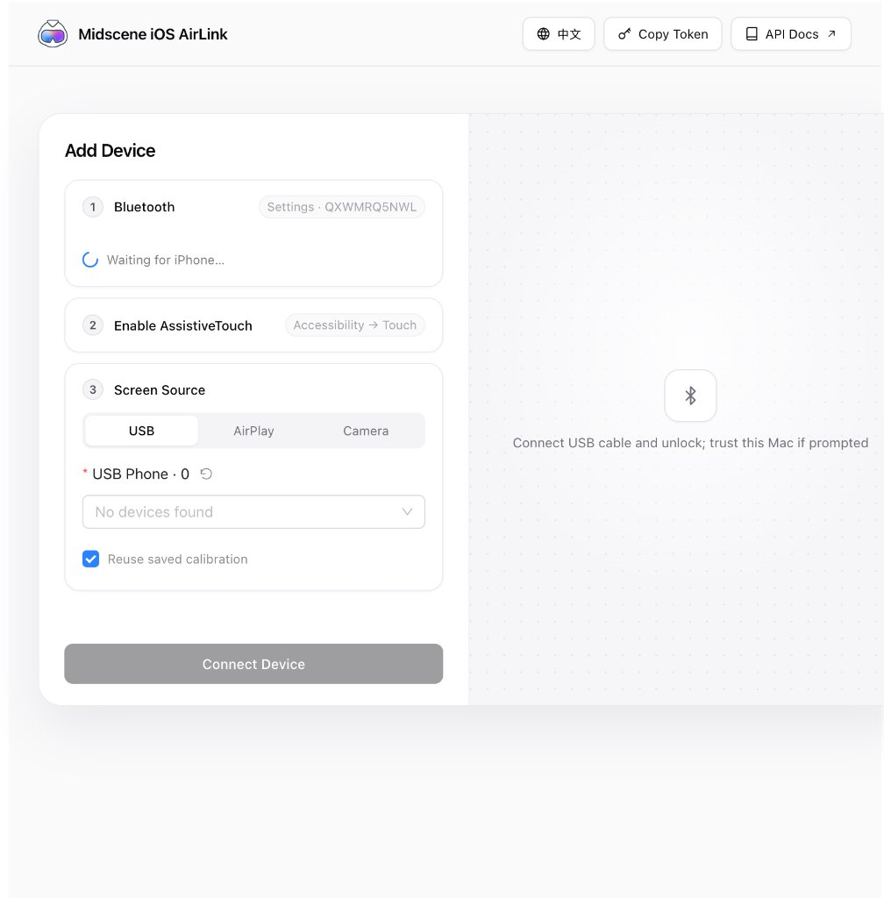

<details>
<summary>Run from a repository checkout</summary>

See the [contributing guide](../../CONTRIBUTING.md) to set up pnpm, then build and start from the repo root:

```sh
pnpm install --frozen-lockfile
pnpm --filter @midscene/ios-airlink... -r build
pnpm ios-airlink start
```

</details>

### 2. Bluetooth Pairing & AssistiveTouch

1. In **Add Device**, note the name under **Bluetooth**.
2. On the iPhone, open **Settings → Bluetooth** and pair with that name. (If multiple phones appear in the manager, select the one you just paired.)
3. On the iPhone, enable **Settings → Accessibility → Touch → AssistiveTouch**. Keep the phone unlocked during setup.

<table>
  <tr>
    <th align="center">Mac: Add Device</th>
    <th align="center">iPhone: Bluetooth</th>
    <th align="center">iPhone: AssistiveTouch</th>
  </tr>
  <tr>
    <td align="center">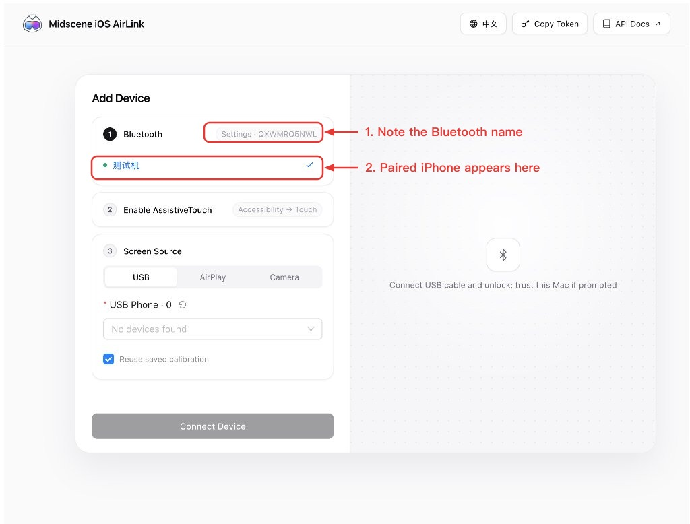</td>
    <td align="center">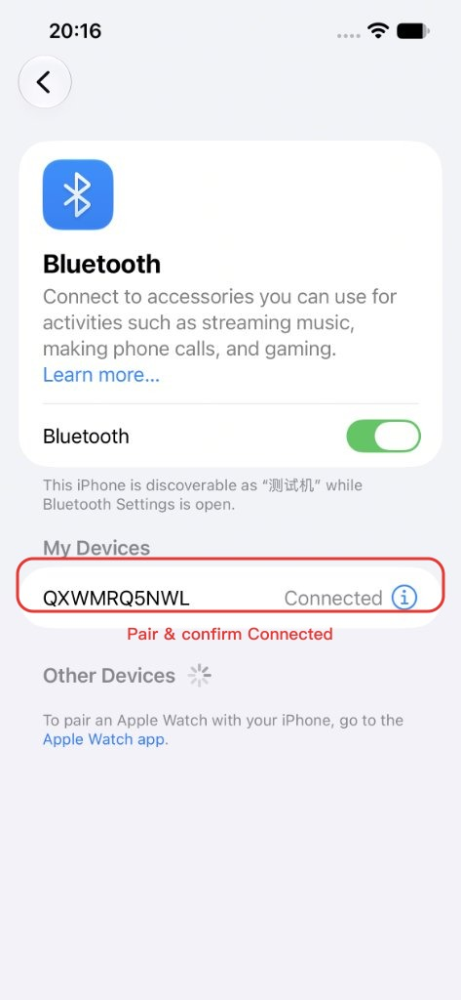</td>
    <td align="center">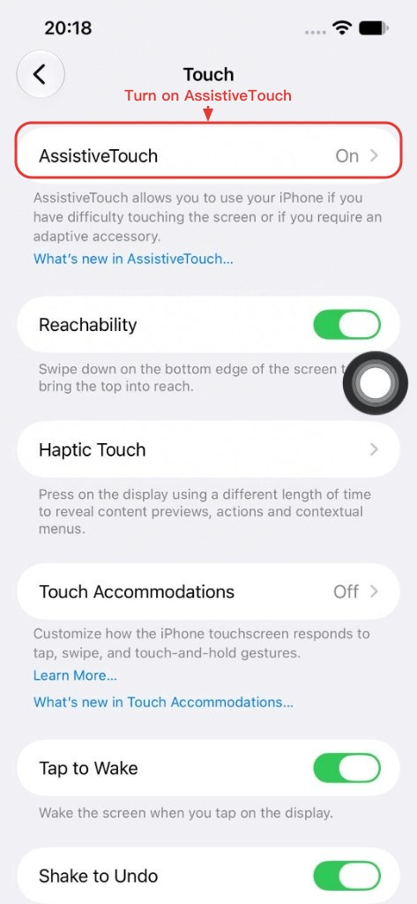</td>
  </tr>
</table>

### 3. Screen Source Setup

> [!NOTE]
> Pointer calibration takes a short while across all three screen sources (USB, AirPlay, and Camera). Wait patiently without touching or locking the iPhone. If calibration fails or times out, click **Connect Device** (or **Confirm & Verify Pointer**) to retry.

Under **Screen Source**, pick **USB**, **AirPlay**, or **Camera**.

#### USB

1. Plug the iPhone into the Mac with a data cable and tap **Trust** if prompted.
2. Select **USB**, pick the iPhone from the list, and click **Connect Device**.
3. Wait for the live preview and pointer calibration to finish. Keep the cable plugged in while testing.

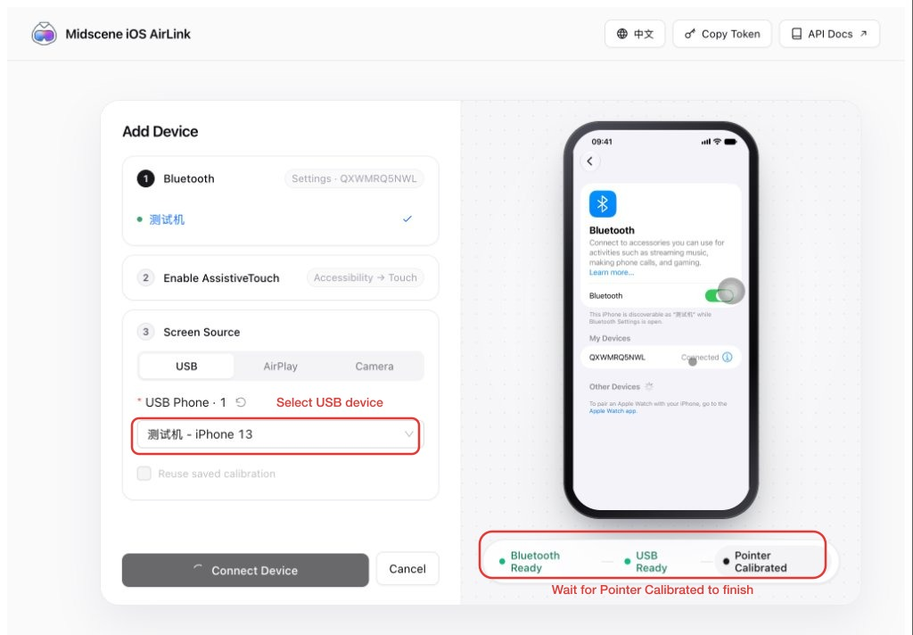

#### AirPlay

1. Ensure [UxPlay is installed](#optional-install-uxplay-airplay-only).
2. Select **AirPlay** and click **Start AirPlay Receiver**. Note the receiver name and passcode.
3. On the iPhone, open **Control Center → Screen Mirroring**, choose that receiver, and enter the passcode.
4. Keep mirroring active until **AirPlay Ready** and **Pointer Calibrated** appear.

<table>
  <tr>
    <th align="center">Mac: AirPlay Receiver</th>
    <th align="center">iPhone: Screen Mirroring</th>
  </tr>
  <tr>
    <td align="center">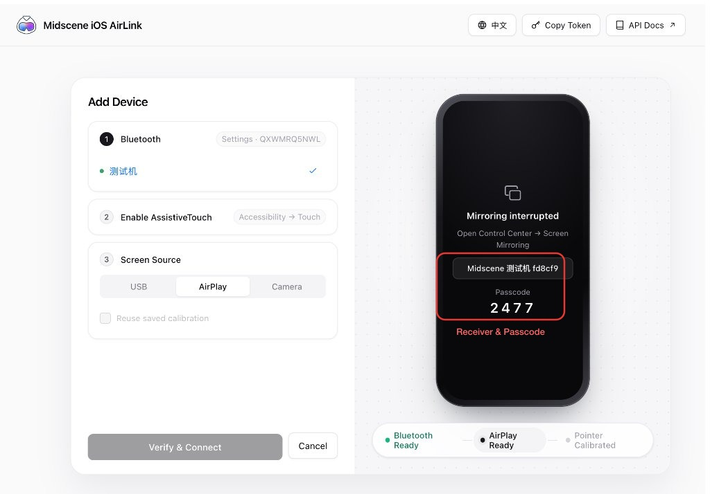</td>
    <td align="center">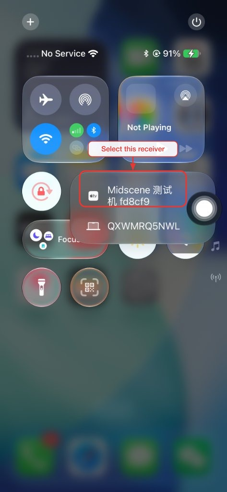</td>
  </tr>
</table>

#### External Camera

1. Mount the camera so the full iPhone screen is in frame, and keep both fixed.
2. Select **Camera**, pick the camera, and click **Connect Device**.
3. Make sure the iPhone is on the same network as the Mac, scan the QR code, add the helper page to the Home Screen as instructed, and open it from there.
4. Click **Next: Camera Calibration**, adjust the detected corners if needed, then click **Confirm & Verify Pointer**. Don't move the phone or camera afterward.

<table>
  <tr>
    <th align="center">1. Camera Setup</th>
    <th align="center">2. Scan QR</th>
    <th align="center">3. Add to Home</th>
    <th align="center">4. Markers</th>
    <th align="center">5. Calibrate</th>
  </tr>
  <tr>
    <td align="center">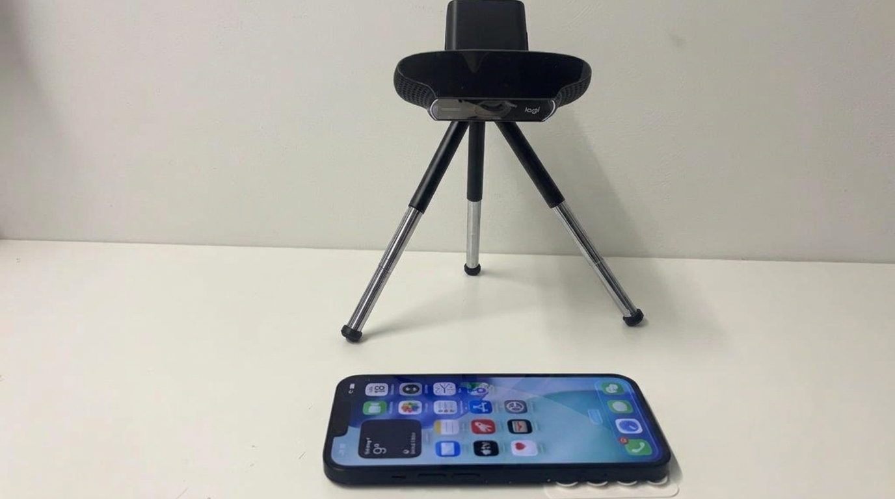</td>
    <td align="center">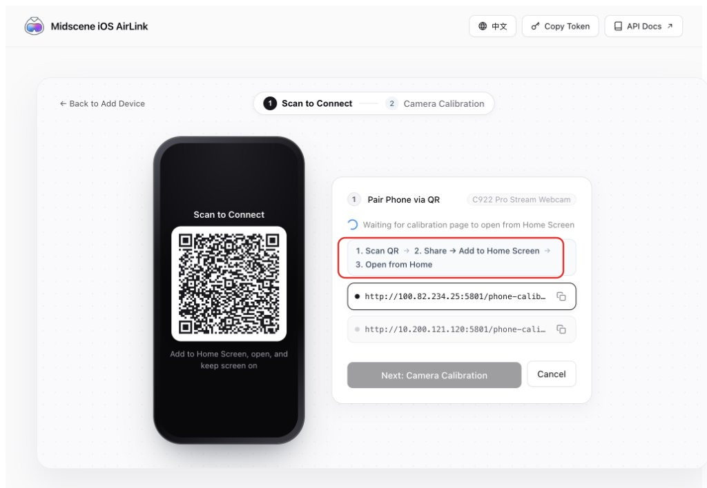</td>
    <td align="center">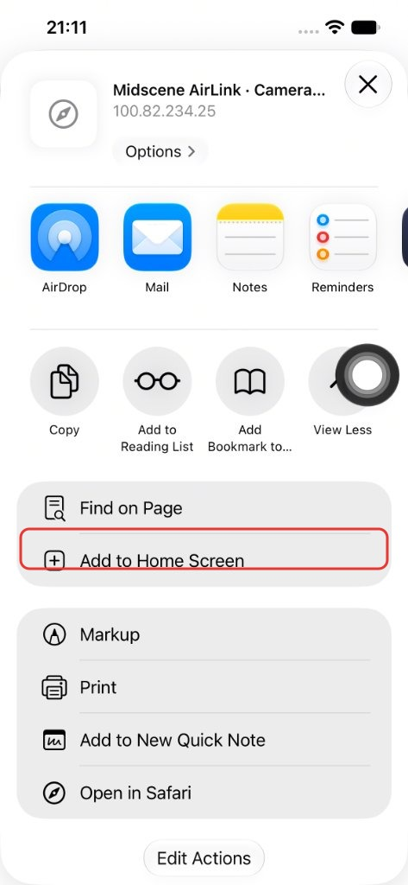</td>
    <td align="center">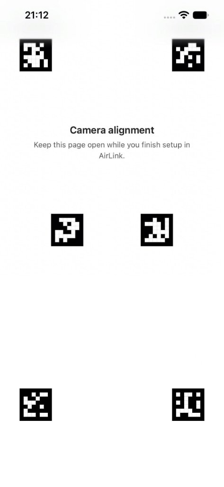</td>
    <td align="center">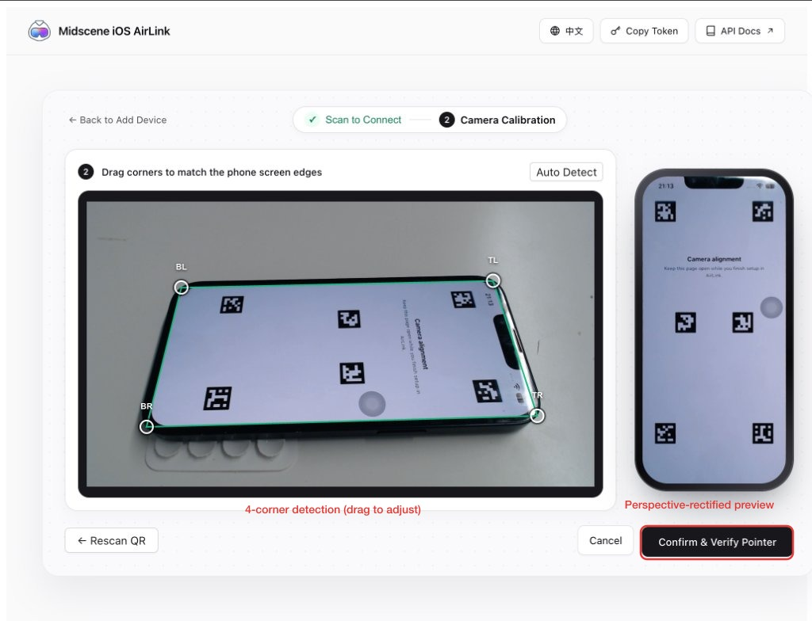</td>
  </tr>
</table>

### 4. Verify Connection

The device card should show **Connected** with a live preview, and its details should show **Bluetooth HID: Connected** and **Pointer: Verified**. Swipe on the iPhone to confirm the preview updates.

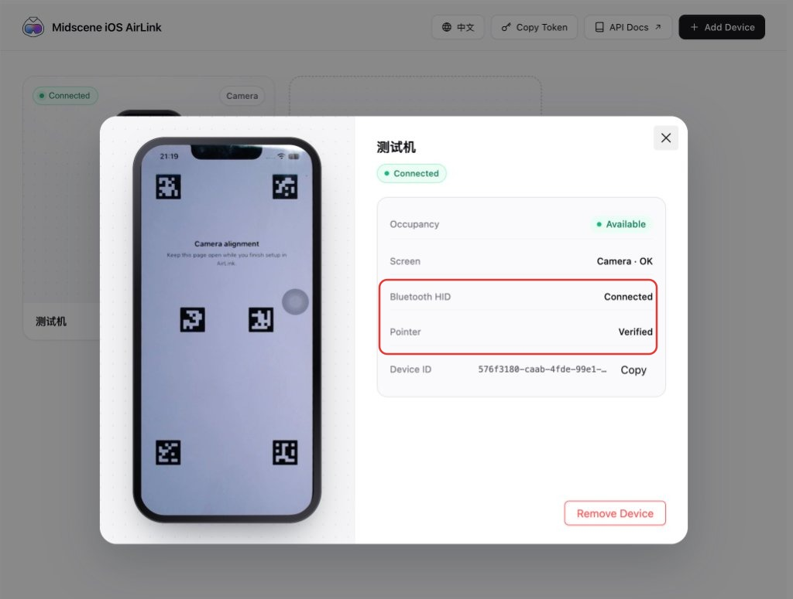

## 🧪 First Test

Once a device is added, write tests against it in natural language:

```js
import { agentOverConnectProtocol } from '@midscene/connect';

const agent = await agentOverConnectProtocol({
  url: 'http://localhost:5801/devices/<device-id>',
  token: process.env.MIDSCENE_CONNECT_TOKEN, // from `ios-airlink token`
});

try {
  await agent.aiAct('Open the Settings app and tap General');
  await agent.aiAssert('The Settings page titled General is visible');
} finally {
  await agent.destroy();
}
```

- **Device URL:** Copy the device ID from the device details, or list devices with `curl -H "Authorization: Bearer $MIDSCENE_CONNECT_TOKEN" http://localhost:5801/devices`.
- **Remote host:** Replace `localhost` with the **Connect** address printed when AirLink starts and allow port `5801` in the macOS firewall.
- **CLI:** `MIDSCENE_CONNECT_URL=http://localhost:5801/devices/<device-id> npx @midscene/connect act --prompt "..."`.

## 🛠️ Troubleshooting

| Symptom | What to check |
| --- | --- |
| Preview works, but taps don't | Check **Bluetooth HID** and **AssistiveTouch**. If pointer verification stalls, leave the iPhone unlocked on a still, bright screen where the pointer is visible. |
| iPhone missing from USB list | Unlock the phone, accept **Trust**, use a data cable, and check **System Settings → Privacy & Security → Camera**. |
| AirPlay won't start or isn't discoverable | Run `command -v uxplay` (it must be on the service `PATH`), and verify both devices are on the same LAN. |
| Camera helper won't open or calibration fails | Ensure the iPhone can reach the Mac's LAN IP and opens the helper from the Home Screen. Keep all markers inside the frame and reduce glare. |
