<p align="center">
  <br />
</p>

<h1 align="center">iOS AirLink</h1>

<p align="center">
  <strong>用 Mac 自动化测试任意 iPhone 真机。</strong><br />
  用 Midscene GUI Agent 和蓝牙 HID 操控 iPhone——无需越狱、无需开启开发者模式，一台 Mac 可同时管理多台设备。
</p>

<p align="center">
  <a href="../../README.zh.md">Midscene Test Everything</a> ·
  <a href="./README.md">English</a> / 简体中文
</p>

> 🎥 _视频占位 · USB 连接 iPhone 真机，终端运行第一个测试，展示手机打开「设置 → 通用」且断言通过。_

## 💡 简介

**iOS AirLink** 是 **Universal Device 协议**面向 iPhone 真机的实现，以本地服务的形式运行在 Mac 上，让 Midscene 和各类 AI Agent 像真人一样直接操控未修改过的真机。

传统的 iOS 自动化方案（如 Appium / WebDriverAgent）通常需要开启开发者模式、配置 Xcode 签名与描述文件，甚至每 7 天重签一次。AirLink 绕开了这些限制——通过画面采集和蓝牙外设模拟，零侵入地完成真机端到端测试。

- **手机端零侵入**：无需越狱、无需开启开发者模式、无需安装测试 App 或重签证书。
- **不挑 App 与场景**：系统设置、第三方应用、跨 App 跳转都能测；遇到禁止录屏的页面，还可切换外置相机采集。
- **三种画面 + 一机多控**：支持 USB 直连、AirPlay 投屏、外置相机三种画面来源，一台 Mac 可同时管理多台 iPhone。
- **原生兼容 Midscene 生态**：作为 Universal Device 的标准设备服务，开箱支持 `aiAct`、`aiAssert`、`aiQuery` 以及 CLI 和 MCP 调用。

## 🔌 工作原理

```text
┌────────────────────┐                    ┌─────────────────────────┐                                   ┌────────┐
│                    │ <-- Screenshots -- │ Universal Device (HTTP) │                                   │        │
│                    │ ---- Actions ----> │                         │                                   │        │
│ Midscene GUI Agent │                    ├─────────────────────────┤ <-- USB ------------------------- │ iPhone │
│                    │                    │                         │ <-- AirPlay --------------------- │        │
│                    │                    │    iOS AirLink (Mac)    │ <-- Camera (Perspective) -------- │        │
│                    │                    │                         │ --------- Bluetooth HID --------> │        │
└────────────────────┘                    └─────────────────────────┘                                   └────────┘
```

- **画面采集**：支持 USB、AirPlay 和独立摄像头三种方式（USB 线仅传输画面）。
- **蓝牙操控与校准**：点击、滑动和键盘输入通过蓝牙 HID 发送；开启 iOS「辅助触控」显示指针后，AirLink 会识别指针位置完成坐标校准。

## 📋 环境要求

- **硬件**：一台开启蓝牙的 Mac（仅支持 macOS），以及一台可解锁的 iPhone。
- **Node.js**：`20.19+`（20.x）、`22.12+`（22.x）或 `24+`（通过 `node --version` 检查）。
- **Xcode Command Line Tools**：用于编译原生组件（通过 `xcode-select -p` 检查，缺失时运行 `xcode-select --install`）。
- **系统权限**：首次运行时，按 macOS 弹窗提示允许蓝牙和相机/采集权限。

可以根据测试场景灵活选择画面来源，并准备对应环境：

| 画面来源 | 适用场景 | 特点 | 额外准备 |
| --- | --- | --- | --- |
| **USB 直连**（推荐） | 日常主力测试 | 画质最好、延迟最低 | 支持数据传输的 USB 线 |
| **AirPlay 投屏** | 无线桌面调试 | 免插线，需同一局域网 | 同局域网 + Mac 安装 UxPlay |
| **独立摄像头** | 禁止录屏 / 受保护页面 | 无软件侵入，需固定机位 | 摄像头、固定支架 + 同局域网 |

<details>
<summary>可选：为 AirPlay 安装 UxPlay（仅 AirPlay 需要）</summary>

```sh
brew install cmake pkg-config libplist openssl@3 gstreamer
git clone https://github.com/FDH2/UxPlay.git
cd UxPlay && cmake -B build && cmake --build build && sudo cmake --install build
command -v uxplay
```

详细编译选项见 [UxPlay 官方 macOS 指南](https://github.com/FDH2/UxPlay)。

</details>

## ⚡ 快速开始

### 1. 启动服务

```sh
npx @midscene/ios-airlink install
```

打开终端输出里 **Manage** 对应的地址（默认 `http://localhost:5801/`），点击 **添加设备（Add Device）**。

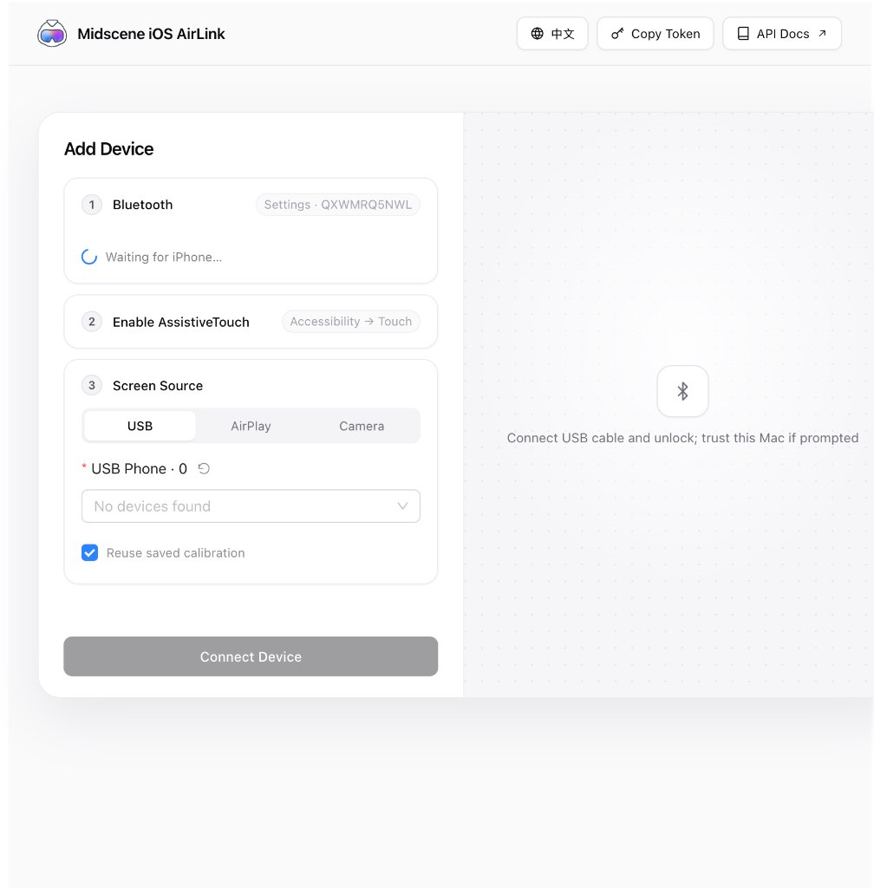


<details>
<summary>从本地仓库源码运行</summary>

参考[贡献指南](../../CONTRIBUTING.md)配置好 pnpm 后，在仓库根目录构建并安装：

```sh
pnpm install --frozen-lockfile
pnpm --filter @midscene/ios-airlink... -r build
pnpm ios-airlink install
```

后续在仓库根目录用 `pnpm ios-airlink <命令>` 管理服务即可。

</details>

### 2. 配对蓝牙与开启辅助触控

1. 在 **添加设备** 弹窗的 **蓝牙连接** 一栏记下蓝牙名称。
2. 在 iPhone 上打开 **设置 → 蓝牙** 配对该名称（若管理页列出多台手机，选中刚配对的那台）。
3. 在 iPhone 上开启 **设置 → 辅助功能 → 触控 → 辅助触控**。配置期间保持手机解锁。

<table>
  <tr>
    <th align="center">Mac：添加设备</th>
    <th align="center">iPhone：蓝牙配对</th>
    <th align="center">iPhone：辅助触控</th>
  </tr>
  <tr>
    <td align="center">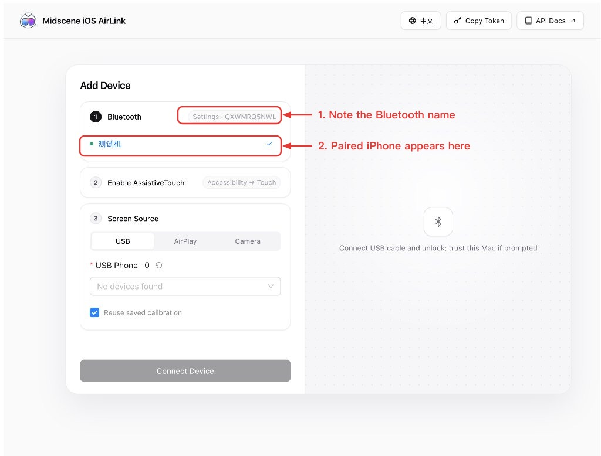</td>
    <td align="center">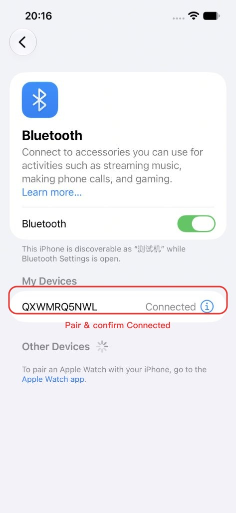</td>
    <td align="center">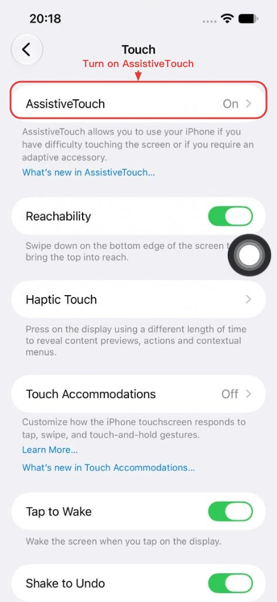</td>
  </tr>
</table>

### 3. 接入画面来源

> [!NOTE]
> 三种画面来源（USB、AirPlay、独立摄像头）在连接时都会执行指针校准，耗时约数十秒。校准期间请耐心等待，不要操作或锁定手机；如遇失败或超时，重试连接即可。

在 **画面来源（Screen Source）** 中任选一种方式：

#### USB 直连

1. 用数据线连接 iPhone 和 Mac，手机弹出信任提示时点击 **信任**。
2. 选择 **USB**，选中你的 iPhone，点击 **连接设备（Connect Device）**。
3. 等待画面预览和指针校准完成。测试期间保持数据线连接。

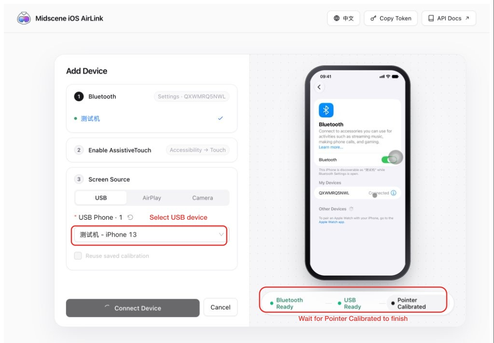

#### AirPlay 投屏

1. 确认已[安装 UxPlay](#可选为-airplay-安装-uxplay仅-airplay-需要)。
2. 选择 **AirPlay**，点击 **启动 AirPlay 接收器（Start AirPlay Receiver）**，记录名称和配对码。
3. 在 iPhone 上打开 **控制中心 → 屏幕镜像**，选择同名接收器并输入配对码。
4. 保持投屏，等待页面显示 **AirPlay 画面就绪** 和 **指针校准** 通过。

<table>
  <tr>
    <th align="center">Mac：AirPlay 接收器</th>
    <th align="center">iPhone：屏幕镜像</th>
  </tr>
  <tr>
    <td align="center">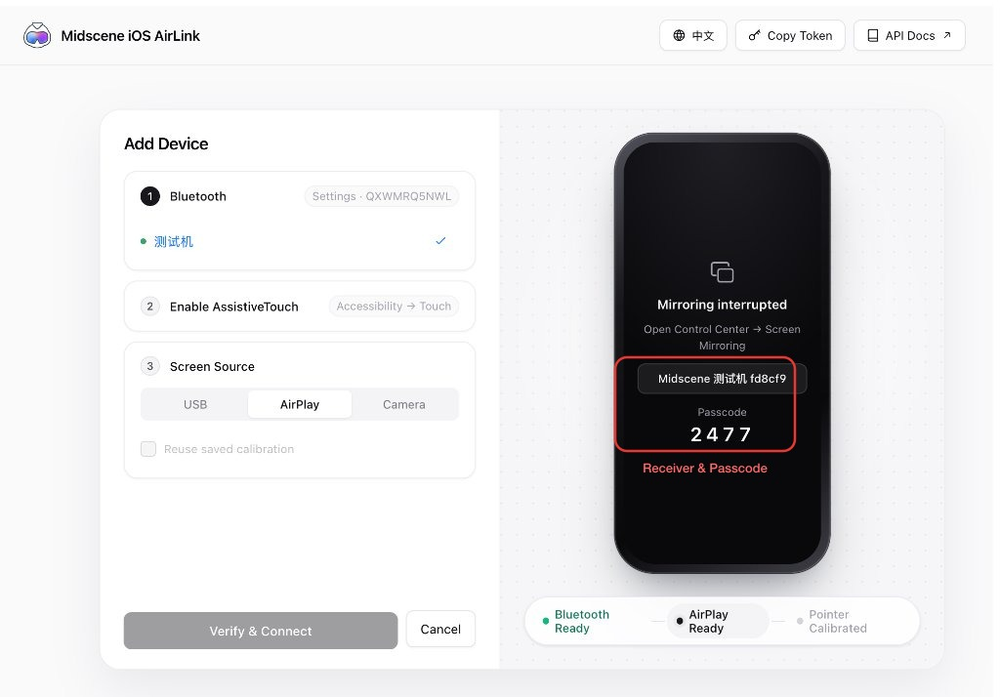</td>
    <td align="center">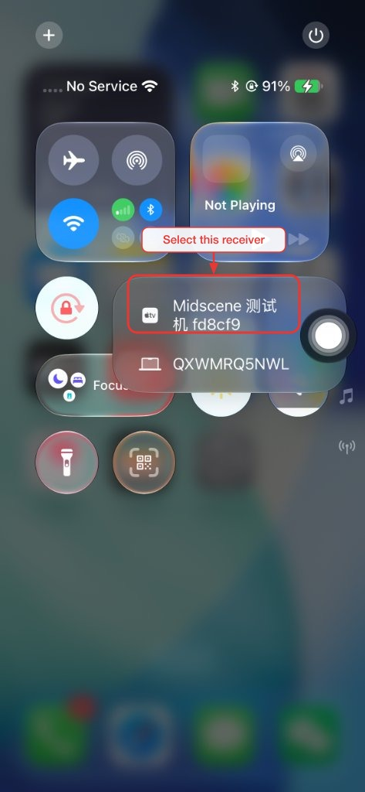</td>
  </tr>
</table>

#### 外置相机

1. 架好摄像头，确保取景框完整覆盖 iPhone 屏幕，固定好手机和摄像头。
2. 选择 **独立摄像头（Camera）**，选中摄像头后点击 **连接设备**。
3. 确保 iPhone 与 Mac 在同一局域网，使用待测 iPhone 扫描二维码，按提示将辅助页添加到主屏幕并从主屏幕打开。
4. 点击 **下一步：相机校正**，微调识别出的四角位置后，点击 **确认并验证指针（Confirm & Verify Pointer）**。校准后不要再移动手机或摄像头。

<table>
  <tr>
    <th align="center">1. 摆位实拍</th>
    <th align="center">2. 扫描二维码</th>
    <th align="center">3. 添加到主屏幕</th>
    <th align="center">4. 标定标记页</th>
    <th align="center">5. 相机校正</th>
  </tr>
  <tr>
    <td align="center">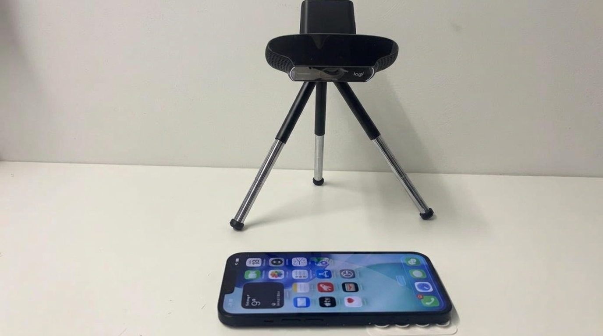</td>
    <td align="center">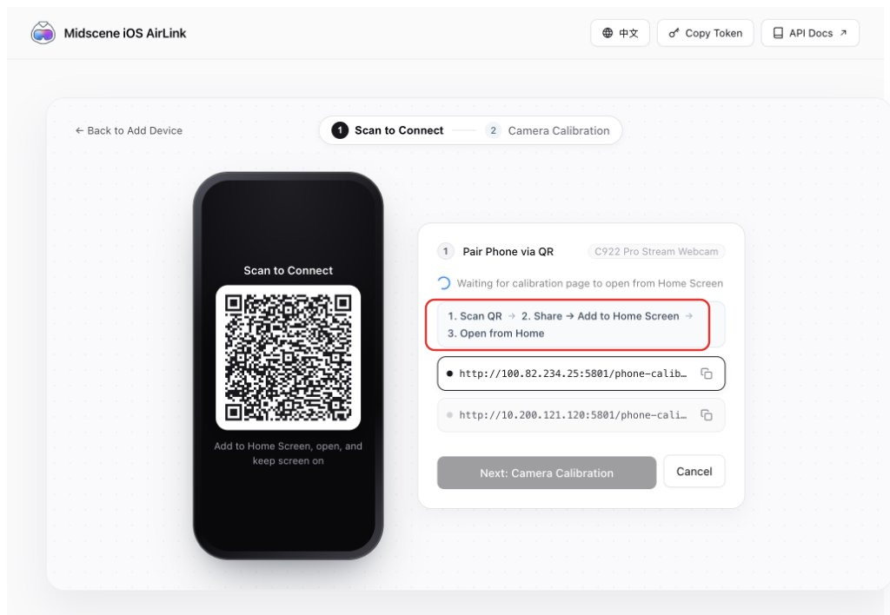</td>
    <td align="center">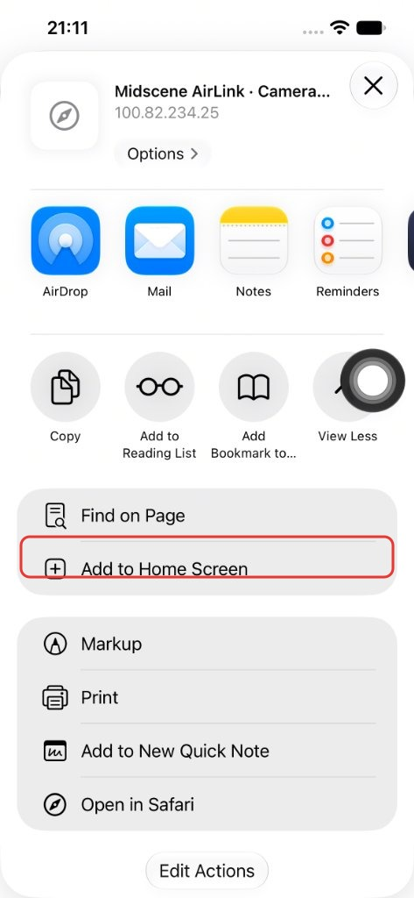</td>
    <td align="center">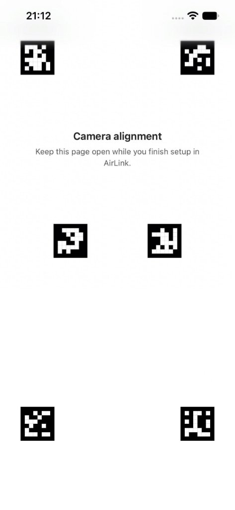</td>
    <td align="center">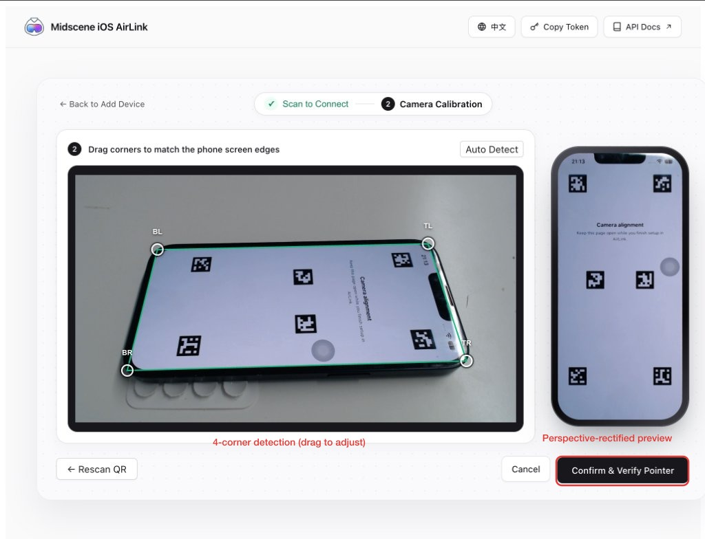</td>
  </tr>
</table>

### 4. 验证连接

设备卡片应显示 **连接正常** 并出现实时画面，详情中 **蓝牙键鼠** 为 **已连接**、**指针验证** 为 **已通过**。在手机上滑动屏幕，确认预览画面同步更新即可。

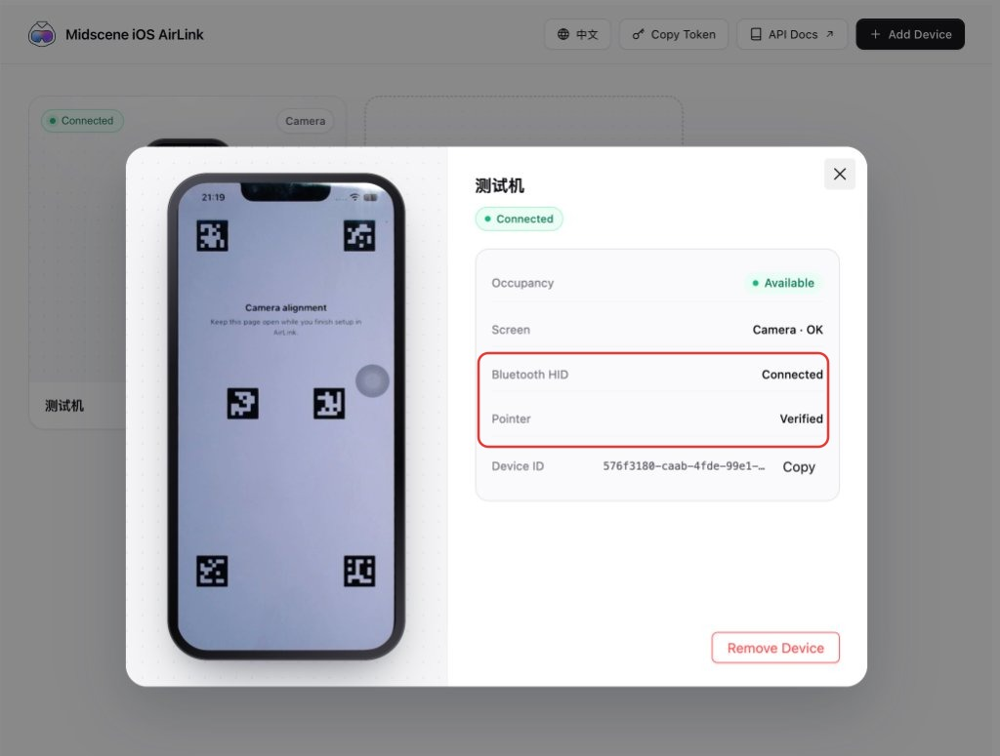

## 🧪 运行测试

添加设备后，就可以用自然语言编写测试：

```js
import { agentFromUniversalDevice } from '@midscene/universal-device';

const agent = await agentFromUniversalDevice({
  host: 'http://localhost:5801',
});

try {
  await agent.aiAct('打开「设置」App，然后点击「通用」');
  await agent.aiAssert('屏幕上显示设置里的「通用」页面');
} finally {
  await agent.destroy();
}
```

- **远程运行**：将 `host` 改为 `ios-airlink status` 输出的 **Connect** 地址，并放行 `5801` 端口。
- **多台设备**：在设备详情复制 `deviceId` 传入 `agentFromUniversalDevice`。

## 🛠️ 故障排查

| 现象 | 排查方向 |
| --- | --- |
| 有画面但手机没反应 | 检查 **蓝牙键鼠** 和 **辅助触控**。指针验证卡住时，让 iPhone 停在静止、明亮、能看清光标的页面。 |
| USB 列表找不到手机 | 解锁手机并点击 **信任**，确认使用数据线，检查 **系统设置 → 隐私与安全性 → 相机** 权限。 |
| AirPlay 启动失败或搜不到 | 确认 `command -v uxplay` 在服务 `PATH` 中可见，且 Mac 与 iPhone 在同一局域网。 |
| 独立摄像头的辅助页打不开或校正失败 | 确认 iPhone 能访问 Mac 的局域网 IP，并从主屏幕打开辅助页；保证四角标记完整入镜且无明显反光。 |
