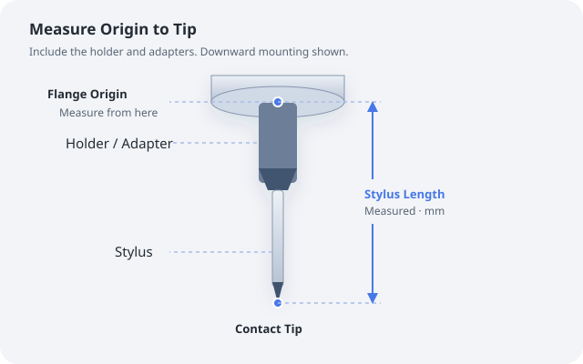
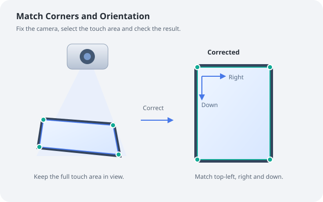
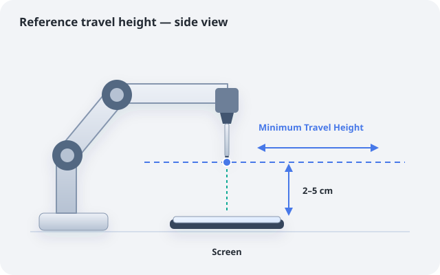
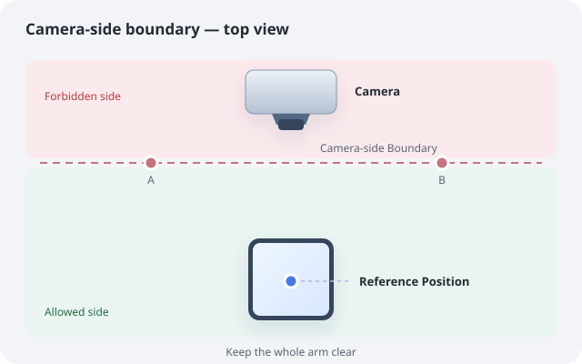

<p align="center">
  <br />
</p>

# DOBOT MG400 device service

English / [简体中文](./README.zh.md)

`@midscene/mg400-service` connects a DOBOT MG400 and an overhead camera to Midscene through Universal Device. The camera captures the screen, and a stylus mounted on the robot arm taps and swipes the physical touchscreen. This lets you test in-car displays and embedded interfaces without changing the device software.

## Run locally

From the repository root, run the following commands.

```sh
pnpm install
pnpm dev
```

Open the URL printed in the terminal and confirm that the MG400 is connected in the management UI.

Run `pnpm dev --manual` to specify the controller IP address. Run `pnpm dev:mock` to try the management UI with a simulated arm.

## Calibrate a touchscreen

Secure the stylus, screen, and overhead camera with the full touch area in view. The target screen must be able to open the calibration page over the local network. Open **Calibration** in the management UI.

### 1. Touch Tool

- **Required** — Enter the combined weight of the stylus, holder, and adapters (0–0.75 kg). The MG400 mounts the tool straight down (`-Z`).
- **Optional** — For an axial mount, enter the stylus length (mm) from the flange origin to the tip, including the holder and adapters. Leave it blank to use the flange pose at contact.

  

  If the tip is off-axis, enter the measured X/Y/Z offset in millimetres and the contact direction in the flange frame under **Advanced Tool Settings**. Keep the contact direction straight down.
- **Done when** — The wizard opens **Camera Mapping** after you select **Save and Continue**.

### 2. Camera Mapping

- **Required** — Select an online camera and target screen. Use **Connect Phone** to open and bind the calibration page on the target screen, then keep it fullscreen. Select **Detect screen markers** and check that the four corners and orientation match the full touch area.

  

- **Optional** — If marker detection misses the outline, adjust the four corners in **Set Up Perspective** or **Correct Perspective**. If system bars remain visible, follow the page's fullscreen confirmation prompt.
- **Done when** — Save the perspective and confirm if prompted. The checklist shows **Camera mapping confirmed**.

### 3. Teach Installation

- **Required** — For new teaching, enable the arm and enter drag mode as prompted. Record these three poses.
  - **Reference position.** Hold the tip still 20–50 mm above the screen centre and record it as the minimum travel height.

    

  - **Camera-side boundary.** Record A and B at the reference height, at least 20 mm apart. Keep the reference position and screen on the allowed side, with clearance for the whole arm.

    

- **Optional** — If the installation still matches, choose **Use Saved Teaching** when offered. If there is no live boundary overlay, check the line from A to B directly.
- **Done when** — Confirm the screen is horizontal, the stylus vertical, and the travel area clear. Select **Save and Calibrate** to open **Screen Calibration**.

### 4. Screen Calibration

- **Required** — After mapping and teaching, keep the screen's calibration page connected and fullscreen. In drag mode, place the tip 20–50 mm above the screen centre, release the arm, and record the sampling start. Confirm the workspace is clear and start automatic calibration.
- **Optional**
  - Choose **Fast** for a horizontal, securely fixed screen and a compliant stylus. Use **Regular** for individual contact searches or retry in Regular mode if offered.
  - If the fit needs review, inspect the results and follow the prompt to continue boundary verification or resample.
  - If automatic parking fails, record a **Safe Position** clear of the screen and camera, then check that the full screen is visible.
- **Done when** — Hover and contact boundary checks pass and the safe position is set. Confirm the screen, camera, and tool have stayed in place, then select **Save and Use** and check for **Calibration complete**.

### Saved setups and multiple screens

- Restore a saved setup if the hardware is still in place. Recheck camera mapping and controller readiness.
- Camera moved → recheck and confirm camera mapping. Arm moved → redo mechanical calibration. Screen moved → redo both.
- For multiple screens on one camera, map them and keep their pages open. Use **Calibrate multiple screens** to set the order and follow the prompts for a shared safe position.

## Run a test

1. Open the calibrated device in the management UI. Check the corrected preview, then try a tap or swipe to confirm the stylus lands where expected.
2. On the service computer, open the management UI through `localhost`. In settings, under **Universal Device**, select **Show connection details** and copy the service URL and token.
3. Use those credentials in the [Universal Device Playground](../../universal-device-playground/README.md), or run a Midscene test with `agentFromUniversalDevice({ host, token, deviceId })`. Supply `deviceId` when the service exposes multiple devices, and call `agent.destroy()` when the test finishes to release the session. The [Universal Device example](../../../examples/universal-device.ts) shows how to connect and query what's visible on screen.

## Tuning tips

Open **Robot settings → Motion & history → Motion Settings** for the calibrated screen.

- **Press depth.** If the tip lands in the right place but taps intermittently fail, increase **Press Depth (mm)** in small increments. Reduce it if the stylus compresses too far or the screen flexes. Test a tap after each change and use the shallowest depth that registers reliably.
- **Speed.** Lower **Base Speed** and **Base Acceleration** for gentler taps and swipes on the selected screen. To change the whole arm's speed, let it come to a stop, disable it, and adjust **Global Speed (%)** in **Controller Motion Parameters**. Test a motion after re-enabling.
