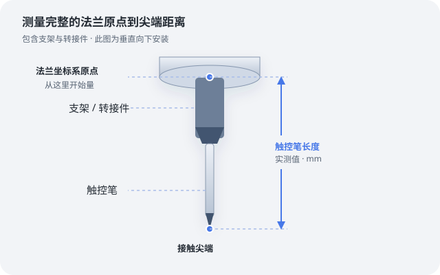
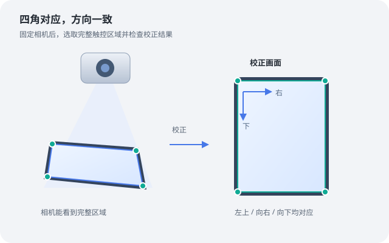
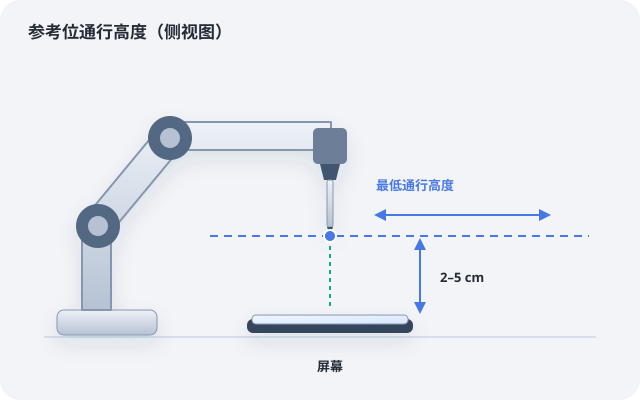
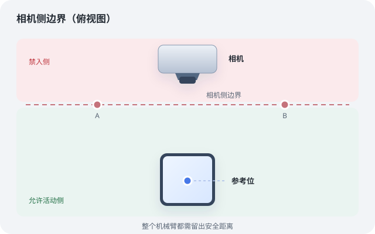

# DOBOT MG400 设备服务

[English](./README.md) / 简体中文

`@midscene/mg400-service` 通过 [Midscene Connect](https://github.com/web-infra-dev/midscene/tree/main/packages/connect) 将 DOBOT MG400 和俯视摄像头接入 Midscene。摄像头采集屏幕画面，机械臂带动触控笔在实体屏幕上点击和滑动，可用于测试车机和嵌入式界面，无需修改被测设备的软件。

## 本地启动

在仓库根目录执行以下命令。

```sh
pnpm install
pnpm dev
```

打开终端输出的地址，在管理台确认 MG400 已连接。

用 `pnpm dev --manual` 手动指定控制器 IP 地址。用 `pnpm dev:mock` 启动模拟机械臂，体验管理台。

## 标定触摸屏

固定触控笔、屏幕和俯视摄像头，让完整触控区域入镜。确认目标屏幕能通过局域网打开标定页，再在管理台打开 **标定**。

### 1. 触控工具

每台机械臂只需配置一次触控工具，各屏幕共用这份工具配置。

- **必填** · 填写触控笔、夹具和转接件的总重量（0–0.75 kg）。MG400 的工具朝正下方（`-Z`）安装。
- **安装方式** · 触控笔垂直向下且与法兰同轴时，在向导中勾选确认。标定使用笔尖接触屏幕时的法兰位姿。

  在 **高级工具设置** 中可以填写实测触控笔长度，或填写法兰坐标系下的 X/Y/Z 偏移和接触方向。长度从法兰原点量到笔尖，计入夹具和转接件。MG400 的接触方向保持垂直向下。

  
- **完成** · 点击 **保存并继续**，向导进入 **相机映射**。

### 2. 相机映射

- **必填** · 选择在线相机和目标屏幕。通过 **连接手机** 在目标屏幕上打开并绑定标定页，保持全屏。点击 **识别屏幕标记**，检查四角和方向是否与完整触控区域一致。

  

- **可选** · 标记识别有偏差时，从 **设置透视** 或 **校正透视** 手动调整四角。若浏览器保留系统栏，按标定页提示确认全屏。
- **完成** · 保存透视，按提示确认，直到检查列表显示 **相机映射已确认**。

### 3. 示教安装

- **必填** · 新做示教时，按提示使能机械臂并进入拖动模式，记录以下三个位姿。
  - **参考位。** 将笔尖静止在屏幕中心上方 20–50 mm，记录为最低通行高度。

    

  - **相机侧边界。** 在参考高度记录 A、B 两点，至少相距 20 mm。参考位和屏幕位于允许侧，整台机械臂须留出避让空间。

    

- **可选** · 当前安装与上次一致时，可按提示 **沿用已保存的示教**。如果没有实时边界叠加，直接核对现场的 A、B 连线。
- **完成** · 确认屏幕水平、触控笔竖直、通行区域无障碍，点击 **保存并标定**，进入 **屏幕标定**。

### 4. 屏幕标定

- **必填** · 完成映射和示教后，保持屏幕标定页连接并全屏。在拖动模式下将笔尖放在屏幕中心上方 20–50 mm，松手后记录采样起点。确认工作区无障碍，开始自动标定。
- **可选**
  - 屏幕水平、固定牢靠且触控笔有弹性时，可选 **快速**。需要逐点探测时选 **普通**，也可按提示用普通模式重试。
  - 提示复核拟合结果时，检查数据，再继续边界验证或重新采样。
  - 自动避让失败时，手动记录避开屏幕和相机的 **安全位置**，确认预览中整块屏幕可见。
- **完成** · 悬停和接触边界验证通过，安全位置已确定。确认屏幕、相机和工具未移动，点击 **保存并启用**，界面显示 **标定完成**。

### 沿用已有配置与多屏标定

- 设备都在原位时，可恢复已有配置。重新使用前检查相机映射和控制器就绪状态。
- 移动相机后重新检查并确认相机映射，移动机械臂后重做机械标定，移动屏幕后两项都重做。
- 同一相机下有多块屏幕时，先逐块完成映射并保持页面打开。选择 **批量标定多个屏幕**，排定顺序并按提示确认共用安全位。
- 相机成像参数按屏幕独立保存。多屏标定时所有目标屏幕参与同一轮对焦、曝光、白平衡和亮度搜索，再由每块屏幕分别选择最佳结果；在管理台切换活动屏幕时，会应用该屏幕保存的参数。

## 运行测试

1. 在管理台打开已标定的设备，检查校正预览，再试点或试滑，确认触控笔落在预期位置。
2. 在运行服务的电脑上通过 `localhost` 打开管理台。在设置的 **Midscene Connect** 区域点击 **查看连接信息**，复制屏幕地址和 Token。
3. 用 `@midscene/connect` 的 `agentOverConnectProtocol({ url, token })` 运行 Midscene 测试，或通过 `npx @midscene/connect playground --url <屏幕地址> --token <token>` 打开 Playground。每块已校准的屏幕都有独立地址（`/devices/<screen-id>`）。[connect 示例](../../../examples/connect.ts) 展示了如何连接设备并查询屏幕内容。

## 调参小技巧

选中已标定的屏幕后，打开 **机械臂配置 → 运动与记录 → 运动参数**。

- **按压深度。** 如果落点准确但偶尔点不动，小幅增加 **按压深度（mm）**。如果笔尖压缩过多或屏幕受压变形，就调浅一些。每次调整后试点，取能稳定触发的最浅深度。
- **速度。** 降低 **基础速度** 和 **基础加速度**，让当前屏幕的点击和滑动更平缓。要调整整台机械臂的速度，等机械臂停稳后解除使能，再到 **控制器运动参数** 调节 **全局速度倍率（%）**。重新使能后试运行一次。
