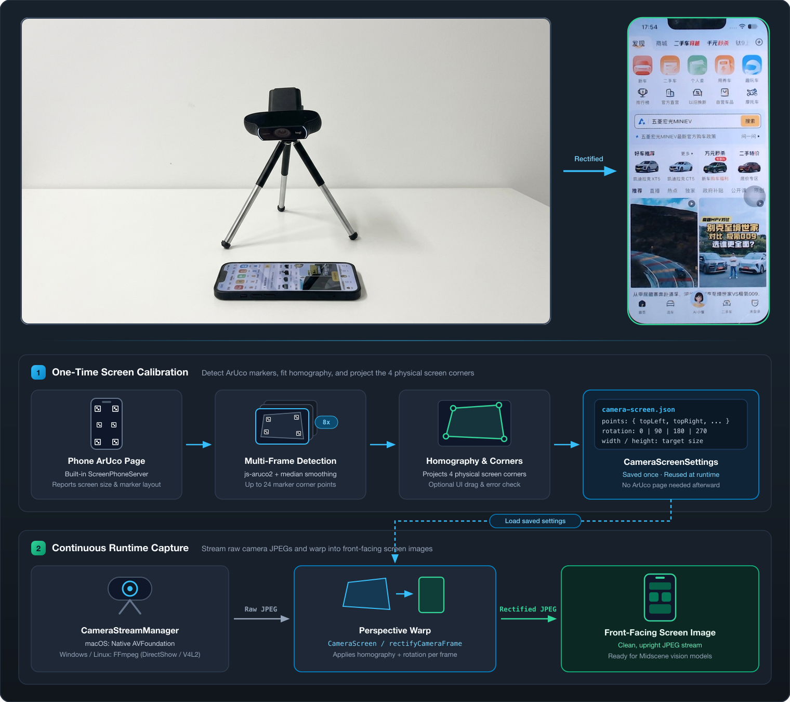
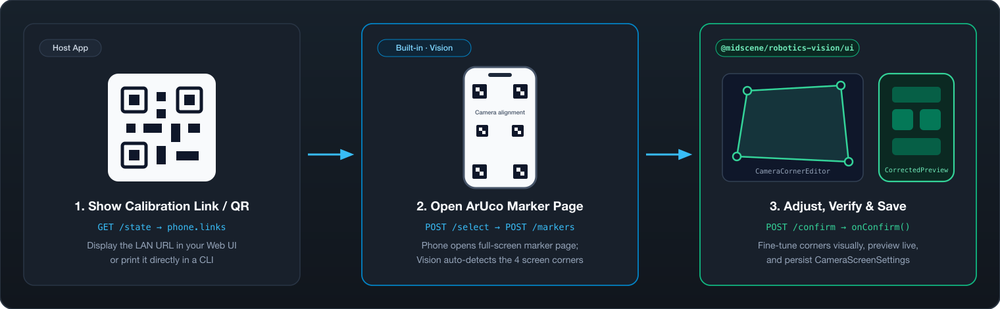

<p align="center">
  <br />
</p>

<h1 align="center">Robotics Vision</h1>

<p align="center">
  <strong>Cross-platform camera capture and screen perspective correction.</strong><br />
  Turn angled camera views of phones and embedded displays into clean, front-facing images for vision models.
</p>

<p align="center">
  <a href="../../../README.md">Midscene Test Everything</a> ·
  English / <a href="./README.zh.md">简体中文</a>
</p>

<p align="center">
  
</p>

## 💡 Overview

`@midscene/robotics-vision` powers camera capture and screen rectification for Midscene Test Everything (such as iOS AirLink external camera mode and robot-arm testing): it streams JPEG frames from cameras and rectifies angled screen captures into front-facing views using ArUco calibration and perspective warping.

- **Cross-platform capture:** Stream raw JPEG frames on macOS (native AVFoundation), Windows, and Linux (FFmpeg).
- **One-time ArUco calibration:** The phone opens the built-in ArUco page in full screen and reports its screen dimensions and marker layout. Vision captures 8 raw frames, fits a homography to project the 4 screen corners (including insets), verifies alignment error, and saves `CameraScreenSettings`.
- **Continuous perspective warp:** Once `CameraScreenSettings` are saved, stream front-facing JPEG frames continuously without keeping the marker page open.

## 📋 Prerequisites

- **Node.js:** `20.19+` (20.x), `22.12+` (22.x), or `24+`.
- **macOS:** Install Xcode Command Line Tools (`xcode-select --install`) and grant camera permission. Capture uses native AVFoundation.
- **Windows / Linux:** Uses the bundled FFmpeg dependency by default. Set `ROBOT_VISION_FFMPEG_PATH` to use a custom FFmpeg binary (DirectShow on Windows, V4L2 on Linux).
- **Screen calibration:** Mount the camera so all four screen corners stay in frame. The device under test must be able to reach the calibration page served by your computer (for example, over the same LAN).

## ⚡ Quick Start

### Installation

```sh
npm install @midscene/robotics-vision
```

### 1. Capture a Camera Frame

Save the following as a Node.js ESM script (`.mjs`). It discovers external cameras, opens the first stream, saves a JPEG to `frame.jpg`, and cleans up:

```js
import { writeFile } from 'node:fs/promises';
import {
  CameraStreamManager,
  cameraBackend,
  listCameras,
} from '@midscene/robotics-vision';

const [camera] = await listCameras();
if (!camera) throw new Error('Connect a camera first');

const streams = new CameraStreamManager(cameraBackend());

try {
  const stream = await streams.create({
    deviceId: camera.id,
    ...camera.defaultCaptureSettings,
  });
  const { jpeg } = await stream.getFrame({ fresh: true, timeoutMs: 5_000 });
  await writeFile('frame.jpg', jpeg);
} finally {
  await streams.close();
}
```

- Each `CameraStreamManager` maintains at most one active stream per camera.
- For live frame processing, subscribe to `stream.on('frame', ({ jpeg, capturedAt }) => { ... })` and call `streams.close()` on shutdown.

### 2. Read Rectified Screen Frames

Once you have `camera-screen.json` (generated via [Interactive Screen Calibration](#-interactive-screen-calibration) below), wrap the camera stream with `CameraScreen` to read front-facing frames:

```js
import { readFile, writeFile } from 'node:fs/promises';
import {
  CameraScreen,
  CameraStreamManager,
  cameraBackend,
} from '@midscene/robotics-vision';

const settings = JSON.parse(await readFile('camera-screen.json', 'utf8'));
const streams = new CameraStreamManager(cameraBackend());

try {
  const stream = await streams.create({
    deviceId: settings.cameraId,
    ...settings.capture,
  });
  const screen = new CameraScreen(stream, settings);
  const { jpeg } = await screen.getFrame({ timeoutMs: 5_000 });
  await writeFile('screen.jpg', jpeg);
} finally {
  await streams.close();
}
```

- To rectify an existing raw JPEG Buffer directly, call `rectifyCameraFrame(jpeg, settings)`.
- Recalibrate whenever the camera mount, framing, or capture resolution changes.

<details>
<summary>Example camera-screen.json structure</summary>

```json
{
  "cameraId": "cam-1",
  "capture": {
    "width": 1920,
    "height": 1080,
    "fps": 30
  },
  "width": 390,
  "height": 844,
  "correction": {
    "sourceWidth": 1920,
    "sourceHeight": 1080,
    "rotation": 0,
    "points": {
      "topLeft": { "x": 420, "y": 180 },
      "topRight": { "x": 1480, "y": 160 },
      "bottomRight": { "x": 1520, "y": 920 },
      "bottomLeft": { "x": 380, "y": 900 }
    }
  }
}
```

</details>

## 🎯 Interactive Screen Calibration

Use `@midscene/robotics-vision/setup` to generate `CameraScreenSettings` automatically—whether in a Web management backend or a temporary local HTTP server started by a CLI tool. Integration responsibilities:

| Layer | Provided by `@midscene/robotics-vision` | Built by your host app |
| --- | --- | --- |
| **Phone calibration page** | Built-in `ScreenPhoneServer` and full-screen ArUco marker page | Surface `phone.links` from `GET /state` to the user (e.g., as a QR code) |
| **Calibration backend** | Built-in `createCameraSetup()` (stream management, 8-frame marker detection, corner projection, alignment check) | Mount `setup.handle()` on an HTTP route and persist settings in `onConfirm` |
| **Desktop visual UI** | Core React components: `CameraCornerEditor` (drag corners) and `CorrectedPreview` (live preview) | Page shell (camera picker, step wizard, buttons calling `/select`, `/markers`, `/confirm`) |

<p align="center">
  
</p>

### 1. Mount the Calibration HTTP Routes

Mount `setup.handle()` under a route prefix on your HTTP server. When the user confirms calibration, `onConfirm` receives the validated `CameraScreenSettings`:

```js
import { writeFile } from 'node:fs/promises';
import { createServer } from 'node:http';
import { createCameraSetup } from '@midscene/robotics-vision/setup';

const setup = createCameraSetup({
  onConfirm: async (settings) => {
    await writeFile('camera-screen.json', JSON.stringify(settings, null, 2));
  },
});

const prefix = '/camera-setup';
const server = createServer(async (req, res) => {
  const { pathname } = new URL(req.url ?? '/', 'http://localhost');
  if (!pathname.startsWith(`${prefix}/`)) {
    res.writeHead(404).end();
    return;
  }

  try {
    await setup.handle(req, res, pathname.slice(prefix.length));
  } catch (error) {
    res
      .writeHead(400)
      .end(error instanceof Error ? error.message : String(error));
  }
});

server.listen(3000, '127.0.0.1', () => {
  console.log(`http://127.0.0.1:3000${prefix}/state`);
  console.log(`Setup ID: ${setup.id}`);
});

void setup.result
  .finally(async () => {
    server.close();
    await setup.close();
  })
  .catch(console.error);
```

### 2. Use the Corner Editor & Preview Components (Optional)

In a React frontend, import `CameraCornerEditor` and `CorrectedPreview` from `@midscene/robotics-vision/ui` for interactive corner adjustment and client-side live preview:

```tsx
import {
  CameraCornerEditor,
  CorrectedPreview,
} from '@midscene/robotics-vision/ui';

// frameUrl: raw image from GET /frame (Object URL / Data URL)
// correction, size: returned by POST /markers
<CameraCornerEditor
  src={frameUrl}
  value={correction}
  onChange={setCorrection}
/>

<CorrectedPreview
  src={frameUrl}
  correction={correction}
  size={size}
/>
```

See [AirLink camera screen](../../ios-airlink/src/hardware/screen/camera.ts) and [Arm Kit camera session](../../robot-arm/arm-kit/src/camera/session.ts) for full host integrations.

### 3. Calibration HTTP API

Paths are relative to the mount prefix. All `POST` requests require the `X-Midscene-Setup: <setup.id>` header.

**Typical sequence:** `GET /state` → open one of `phone.links` on the phone until `phoneConnected: true` → `POST /select` → `POST /markers` → `POST /confirm`

| Step | Endpoint | Request body (JSON) | Response & behavior |
| --- | --- | --- | --- |
| **1. Get state** | `GET /state` | — | `{ cameras, phone, phoneConnected, layout }`; lists cameras and phone calibration links |
| **2. Select camera** | `POST /select` | `{ cameraId }` | `{}`; opens or reuses the camera stream |
| **3. Detect corners** | `POST /markers` | `{}` | `{ correction, width, height }`; detects ArUco markers once the phone connects |
| **4. Verify & save** | `POST /confirm` | `CameraScreenSettings` | `{}`; checks alignment accuracy, invokes `onConfirm`, and completes the session |
| Optional · Raw frame | `GET /frame` | — | `image/jpeg`; latest raw frame for display or `CameraCornerEditor` |
| Optional · Preview | `POST /preview` | `CameraScreenSettings` | `image/jpeg`; server-side rectified preview image |
| Optional · Check only | `POST /check` | `CameraScreenSettings` | `{ accuracy }`; verifies marker alignment without ending the session |
| Optional · Cancel | `POST /cancel` | `{}` | `{}`; cancels calibration (call `setup.close()` afterward to release resources) |

## 📖 Core APIs

| API | Description |
| --- | --- |
| `listCameras(options?)` | Lists available cameras. Excludes built-in cameras by default (pass `includeBuiltIn: true` to include them). Supports `refresh` and `cachedOnly`. |
| `streams.create(options)` | Opens a camera stream (`deviceId` required). Optional `width` (`1920`), `height` (`1080`), `fps` (`30`), and `horizontalFlip` / `verticalFlip` (`false`). Actual modes depend on hardware support. |
| `stream.getFrame(options?)` | Returns the latest frame or waits if none is buffered. Pass `fresh: true` to wait for the next frame (`timeoutMs` defaults to `2000`). Returns `{ jpeg, id, capturedAt }`. |
| `streams.delete(id)` / `streams.close()` | Closes a single stream by ID, or closes all streams managed by the instance. |
| `createCameraSetup(options)` | Creates a screen calibration session (`onConfirm(settings)` required). Optional `cameraId`, `initialValue`, `streams`, `phone` (reuse a `ScreenPhoneServer`; auto-started on first `/state` if omitted), and `reuseValidatedSettings` (defaults to `false`). |
| `new CameraScreen(stream, settings)` | Wraps a raw camera stream to output rectified screen frames. `settings` includes `cameraId`, optional `capture`, output `width`/`height`, and `correction` (source size, four pixel corners, clockwise rotation `0`/`90`/`180`/`270`). `getFrame()` accepts the same options as `CameraStream`. |
| `rectifyCameraFrame(jpeg, settings)` | Applies `CameraScreenSettings` to a single raw JPEG Buffer and returns the rectified JPEG Buffer. |
