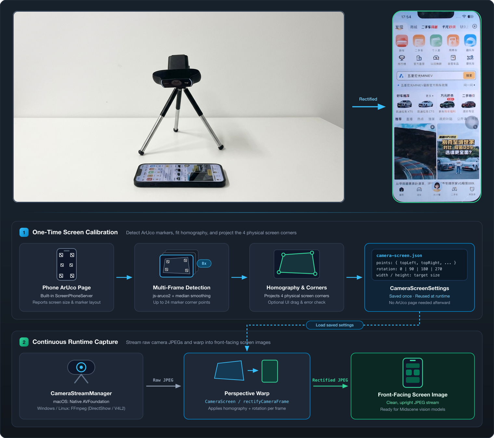
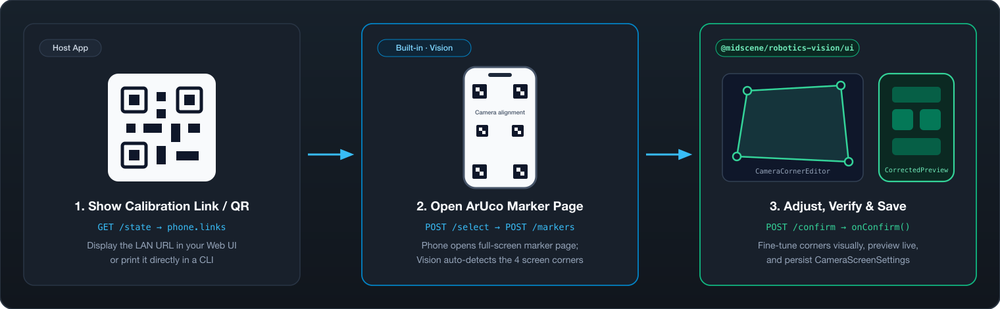

<p align="center">
  <br />
</p>

<h1 align="center">Robotics Vision</h1>

<p align="center">
  <strong>跨平台摄像头采集与屏幕透视校正。</strong><br />
  面向真机与嵌入式设备，输出稳定、正视、可直接交给视觉模型的屏幕图像。
</p>

<p align="center">
  <a href="../../../README.zh.md">Midscene Test Everything</a> ·
  <a href="./README.md">English</a> / 简体中文
</p>

<p align="center">
  
</p>

## 💡 简介

`@midscene/robotics-vision` 为 Midscene Test Everything（如 iOS AirLink 外置相机与机械臂车机测试）提供底层视觉能力：从摄像头采集 JPEG 视频流，并通过 ArUco 标定与透视变换将斜拍的屏幕画面实时校正为正视图。

- **跨平台画面采集**：支持 macOS（原生 AVFoundation）及 Windows / Linux（FFmpeg），统一输出 JPEG 帧流。
- **一次性 ArUco 标定**：手机全屏打开内置 ArUco 标记页并上报屏幕尺寸与标记坐标；摄像头连续采样 8 帧拟合单应性矩阵，反推整块物理屏幕的 4 个真实角点并校验误差，保存为 `CameraScreenSettings`。
- **持续实时透视校正**：加载 `CameraScreenSettings` 后，后续无需标记页，即可对每一帧原始 JPEG 实时做透视变换并输出正视图。

## 📋 环境要求

- **Node.js**：`20.19+`（20.x）、`22.12+`（22.x）或 `24+`。
- **macOS**：安装 Xcode Command Line Tools（`xcode-select --install`）并授予摄像头权限，底层通过系统原生 AVFoundation 采集。
- **Windows / Linux**：默认使用随依赖安装的 FFmpeg；也可通过环境变量 `ROBOT_VISION_FFMPEG_PATH` 指定自定义 FFmpeg（Windows 需支持 DirectShow，Linux 需支持 V4L2）。
- **标定屏幕时**：将摄像头固定在能完整拍到屏幕四角的位置；待测手机需能访问电脑上的标定页（例如两者处于同一局域网）。

## ⚡ 快速开始

### 安装

```sh
npm install @midscene/robotics-vision
```

### 1. 采集摄像头画面

下面是一段完整可运行的 ESM 脚本（`.mjs`）：列出外接摄像头、打开第一台设备的视频流、抓取一帧 JPEG 保存为 `frame.jpg`，然后释放资源。

```js
import { writeFile } from 'node:fs/promises';
import {
  CameraStreamManager,
  cameraBackend,
  listCameras,
} from '@midscene/robotics-vision';

const [camera] = await listCameras();
if (!camera) throw new Error('Connect a camera first');

const streams = new CameraStreamManager(cameraBackend());

try {
  const stream = await streams.create({
    deviceId: camera.id,
    ...camera.defaultCaptureSettings,
  });
  const { jpeg } = await stream.getFrame({ fresh: true, timeoutMs: 5_000 });
  await writeFile('frame.jpg', jpeg);
} finally {
  await streams.close();
}
```

- 每个 `CameraStreamManager` 对同一台摄像头只会维护一条流。
- 若需实时逐帧处理，可订阅 `stream.on('frame', ({ jpeg, capturedAt }) => { ... })`，并在应用退出时再调用 `streams.close()`。

### 2. 输出透视校正后的正视图

获取标定配置 `camera-screen.json`（可通过下一节的[交互式屏幕标定](#-交互式屏幕标定)自动生成）后，使用 `CameraScreen` 包装摄像头流即可直接输出校正后的正视图：

```js
import { readFile, writeFile } from 'node:fs/promises';
import {
  CameraScreen,
  CameraStreamManager,
  cameraBackend,
} from '@midscene/robotics-vision';

const settings = JSON.parse(await readFile('camera-screen.json', 'utf8'));
const streams = new CameraStreamManager(cameraBackend());

try {
  const stream = await streams.create({
    deviceId: settings.cameraId,
    ...settings.capture,
  });
  const screen = new CameraScreen(stream, settings);
  const { jpeg } = await screen.getFrame({ timeoutMs: 5_000 });
  await writeFile('screen.jpg', jpeg);
} finally {
  await streams.close();
}
```

- 若已有单张原始 JPEG Buffer，可直接调用 `rectifyCameraFrame(jpeg, settings)` 进行校正。
- 若摄像头机位、取景范围或采集分辨率发生变化，需要重新标定。

<details>
<summary>查看 camera-screen.json 结构示例</summary>

```json
{
  "cameraId": "cam-1",
  "capture": {
    "width": 1920,
    "height": 1080,
    "fps": 30
  },
  "width": 390,
  "height": 844,
  "correction": {
    "sourceWidth": 1920,
    "sourceHeight": 1080,
    "rotation": 0,
    "points": {
      "topLeft": { "x": 420, "y": 180 },
      "topRight": { "x": 1480, "y": 160 },
      "bottomRight": { "x": 1520, "y": 920 },
      "bottomLeft": { "x": 380, "y": 900 }
    }
  }
}
```

</details>

## 🎯 交互式屏幕标定

通过 `@midscene/robotics-vision/setup` 可以自动生成 `CameraScreenSettings`，Web 管理台或临时启动本地 HTTP 服务的 CLI 工具均可接入。集成时的职责划分如下：

| 环节 | `@midscene/robotics-vision` 已提供 | 宿主应用需要实现 |
| --- | --- | --- |
| **手机端标定页** | 内置 `ScreenPhoneServer` 与全屏 ArUco 标记页 | 将 `GET /state` 返回的 `phone.links` 展示给用户（如生成二维码） |
| **标定后端逻辑** | 内置 `createCameraSetup()`（相机流管理、8 帧标记识别、四角投影与精度校验） | 将 `setup.handle()` 挂载到 HTTP 路由，并在 `onConfirm` 中持久化配置 |
| **电脑端可视化 UI** | 提供核心 React 组件：`CameraCornerEditor`（拖拽调整四角）与 `CorrectedPreview`（实时预览） | 组装页面外壳（选择相机、步骤引导、触发 `/select` / `/markers` / `/confirm` 请求） |

<p align="center">
  
</p>

### 1. 挂载标定 HTTP 路由

将 `setup.handle()` 挂载到你的 HTTP 服务前缀下；用户确认标定后，`onConfirm` 会收到完整的 `CameraScreenSettings`：

```js
import { writeFile } from 'node:fs/promises';
import { createServer } from 'node:http';
import { createCameraSetup } from '@midscene/robotics-vision/setup';

const setup = createCameraSetup({
  onConfirm: async (settings) => {
    await writeFile('camera-screen.json', JSON.stringify(settings, null, 2));
  },
});

const prefix = '/camera-setup';
const server = createServer(async (req, res) => {
  const { pathname } = new URL(req.url ?? '/', 'http://localhost');
  if (!pathname.startsWith(`${prefix}/`)) {
    res.writeHead(404).end();
    return;
  }

  try {
    await setup.handle(req, res, pathname.slice(prefix.length));
  } catch (error) {
    res
      .writeHead(400)
      .end(error instanceof Error ? error.message : String(error));
  }
});

server.listen(3000, '127.0.0.1', () => {
  console.log(`http://127.0.0.1:3000${prefix}/state`);
  console.log(`Setup ID: ${setup.id}`);
});

void setup.result
  .finally(async () => {
    server.close();
    await setup.close();
  })
  .catch(console.error);
```

### 2. 引入前端角点编辑与预览组件（可选）

如果宿主包含 React 前端，可直接引入 `@midscene/robotics-vision/ui` 完成四角拖拽与浏览器端实时透视预览：

```tsx
import {
  CameraCornerEditor,
  CorrectedPreview,
} from '@midscene/robotics-vision/ui';

// frameUrl: 来自 GET /frame 的原始画面（Object URL / Data URL）
// correction, size: 来自 POST /markers 返回的校正参数与目标尺寸
<CameraCornerEditor
  src={frameUrl}
  value={correction}
  onChange={setCorrection}
/>

<CorrectedPreview
  src={frameUrl}
  correction={correction}
  size={size}
/>
```

完整接入示例可参考 [AirLink 相机屏幕](../../ios-airlink/src/hardware/screen/camera.ts) 与 [Arm Kit 相机会话](../../robot-arm/arm-kit/src/camera/session.ts)。

### 3. 标定 HTTP 接口

以下路径均相对于挂载前缀；所有 `POST` 请求需携带请求头 `X-Midscene-Setup: <setup.id>`。

**典型调用顺序**：`GET /state` → 手机打开 `phone.links`（直至 `phoneConnected` 为 `true`）→ `POST /select` → `POST /markers` → `POST /confirm`

| 阶段 | 接口 | 请求体（JSON） | 返回值与说明 |
| --- | --- | --- | --- |
| **1. 获取状态** | `GET /state` | — | `{ cameras, phone, phoneConnected, layout }`；获取摄像头列表与手机标定页链接 |
| **2. 选中相机** | `POST /select` | `{ cameraId }` | `{}`；打开或复用对应摄像头流 |
| **3. 检测四角** | `POST /markers` | `{}` | `{ correction, width, height }`；手机连接后自动检测 ArUco 标记并推算四角 |
| **4. 校验并保存** | `POST /confirm` | `CameraScreenSettings` | `{}`；校验标记对齐精度，通过后触发 `onConfirm` 并结束会话 |
| 可选 · 原始画面 | `GET /frame` | — | `image/jpeg`；抓取最新原始帧，供前端展示或配合 `CameraCornerEditor` 手动调整四角 |
| 可选 · 校正预览 | `POST /preview` | `CameraScreenSettings` | `image/jpeg`；返回服务端透视校正后的预览图 |
| 可选 · 仅测精度 | `POST /check` | `CameraScreenSettings` | `{ accuracy }`；仅检查标记对齐误差，不结束会话 |
| 可选 · 取消会话 | `POST /cancel` | `{}` | `{}`；取消本次标定（会话结束后调用 `setup.close()` 释放资源） |

## 📖 核心 API

| API | 说明 |
| --- | --- |
| `listCameras(options?)` | 列出可用摄像头。默认仅返回外接摄像头（传入 `includeBuiltIn: true` 可包含内置摄像头）；支持 `refresh` 强制刷新与 `cachedOnly` 仅读取缓存。 |
| `streams.create(options)` | 打开视频流，必填 `deviceId`。可选 `width`（默认 `1920`）、`height`（默认 `1080`）、`fps`（默认 `30`），`horizontalFlip` / `verticalFlip` 默认关闭；实际模式取决于硬件能力。 |
| `stream.getFrame(options?)` | 获取最新帧（无缓存时等待）。传入 `fresh: true` 等待下一帧，`timeoutMs` 默认 `2000`。返回 `{ jpeg, id, capturedAt }`。 |
| `streams.delete(id)` / `streams.close()` | 关闭指定流，或关闭该管理器下的全部视频流。 |
| `createCameraSetup(options)` | 创建屏幕标定会话，必填 `onConfirm(settings)`。可选 `cameraId`、`initialValue`、`streams`、`phone`（复用 `ScreenPhoneServer`，省略时首次 `/state` 自动启动）以及 `reuseValidatedSettings`（默认 `false`，开启后可在同流同配置下复用已通过的校验结果）。 |
| `new CameraScreen(stream, settings)` | 将原始相机流包装为校正后的屏幕流。`settings` 包含 `cameraId`、可选 `capture`、输出 `width` / `height` 与 `correction`（原图尺寸、四角坐标与顺时针旋转角度 `0` / `90` / `180` / `270`）。`getFrame()` 参数与 `CameraStream` 一致。 |
| `rectifyCameraFrame(jpeg, settings)` | 对单张原始 JPEG Buffer 应用 `CameraScreenSettings`，返回校正后的 JPEG Buffer。 |
