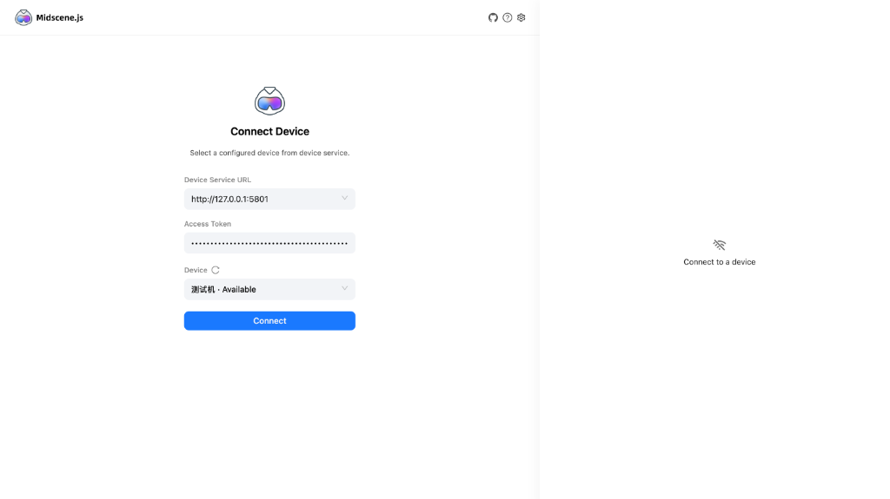
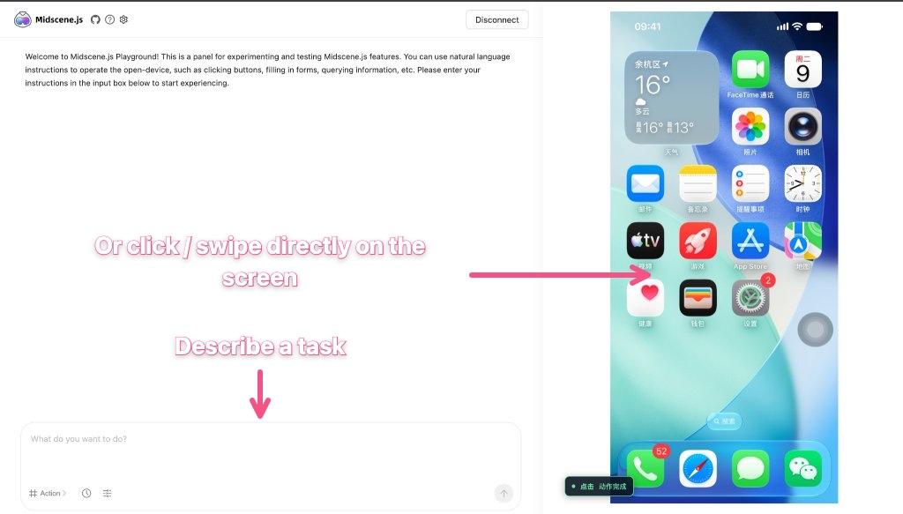

<p align="center">
  <br />
</p>

<h1 align="center">Midscene Universal Device</h1>

<p align="center">
  <strong>One interface to test any device.</strong><br />
  Universal HTTP protocol, SDK, CLI, and MCP server for Midscene.
</p>

<p align="center">
  <a href="../../README.md">Midscene Test Everything</a> ·
  English / <a href="./README.zh.md">简体中文</a>
</p>

## 💡 Overview

Midscene Universal Device is an open, HTTP-based protocol that connects any interactive screen to Midscene and AI agents like Codex, Claude Code, and Cursor.

- **Unified protocol**: Abstracts underlying differences behind standard discovery, exclusive sessions, screenshots, and input APIs.
- **Full Midscene compatibility**: Reuse `aiAct`, `aiAssert`, `aiQuery`, and Midscene's visual testing APIs on any connected device.
- **Flexible interfaces**: Ships with a TypeScript SDK, CLI, MCP server, Skill, and browser Playground for both test scripts and AI agents.
- **Easy to extend**: Wrap custom devices in a few lines with `createDeviceHandler()` without reimplementing the protocol.

```text
 Midscene SDK / CLI / MCP / Skill / Playground
                       │
           Universal Device HTTP API
    Device discovery · Sessions · Screenshots · Input
                       │
   AirLink / DOBOT MG400 service / Your own device service
                       │
             The screen under test
```

## 📋 Prerequisites

- **Node.js**: `20.19+`, `22.12+`, or `24+`.
- **Device service**: Have a service URL and access token ready. If you do not have one yet, try one of the built-in services or [connect your own device](#-connect-your-own-device):
  - **iOS AirLink** (physical iPhone): See the [iOS AirLink guide](../ios-airlink/README.md) (default URL `http://localhost:5801`; copy the token in the manager).
  - **Robot arm** (in-car / touchscreen): See the [DOBOT MG400 service guide](../robot-arm/mg400-service/README.md).

## ⚡ Quick start

### 1. Install and verify the connection

Install `@midscene/universal-device`, export the service URL and token, and verify the connection with the CLI:

```sh
npm install @midscene/universal-device
export MIDSCENE_UNIVERSAL_DEVICE_SERVICE_URL='http://localhost:5801'
export MIDSCENE_UNIVERSAL_DEVICE_SERVICE_TOKEN='<your service token>'

npx @midscene/universal-device devices # List available devices
npx @midscene/universal-device screenshot screen.jpg # Capture the current screen
```

### 2. Run your first visual test

Then write tests in natural language:

```js
import { agentFromUniversalDevice } from '@midscene/universal-device';

const agent = await agentFromUniversalDevice({
  host: process.env.MIDSCENE_UNIVERSAL_DEVICE_SERVICE_URL,
  deviceId: process.env.MIDSCENE_UNIVERSAL_DEVICE_ID,
});

try {
  await agent.aiAct('Open the Settings app and tap General');
  await agent.aiAssert('The Settings page titled General is visible');
} finally {
  await agent.destroy();
}
```

## 🛠️ Usage

### CLI

```sh
# List devices and supported actions
npx @midscene/universal-device devices

# Check the selected device status
npx @midscene/universal-device status

# Capture the current screen
npx @midscene/universal-device screenshot screen.jpg

# Send a tap (origin (0, 0) is the top-left pixel of the screenshot)
npx @midscene/universal-device action '{"type":"tap","point":{"x":120,"y":240}}'
```

A standalone `screenshot` or `action` uses a temporary session. For multi-step sequences, run `acquire` first and `release` when done. See [InputAction](./docs/http-api.md#inputaction) for other action types (`swipe`, `longPress`, `typeText`, `home`, etc.).

### MCP Server

Add this configuration to an MCP client (such as Codex, Claude Code, or Cursor):

```json
{
  "mcpServers": {
    "universal-device": {
      "command": "npx",
      "args": ["-y", "@midscene/universal-device", "mcp"],
      "env": {
        "MIDSCENE_UNIVERSAL_DEVICE_SERVICE_URL": "<your service URL>",
        "MIDSCENE_UNIVERSAL_DEVICE_SERVICE_TOKEN": "<your service token>"
      }
    }
  }
}
```

Once connected, the agent can call `list_devices`, `screenshot`, `execute_action`, and `release_device`.

### Skill

Install the built-in [`universal-device` Skill](../../skills/universal-device/SKILL.md) with:

```sh
npx skills@latest add web-infra-dev/midscene-test-everything --skill universal-device
```

Set `MIDSCENE_UNIVERSAL_DEVICE_SERVICE_URL` and `MIDSCENE_UNIVERSAL_DEVICE_SERVICE_TOKEN` in your environment (or `.env`) to control real devices from agents like Codex, Claude Code, and Cursor.

### Playground

Start [Universal Device Playground](../universal-device-playground/README.md) with:

```sh
npx @midscene/universal-device-playground
```

Enter your service URL and token in the browser to preview the live screen and try actions:

| Connect Device | Live Screen and Actions |
| --- | --- |
|  |  |

## 🧩 Connect your own device

A custom device service only needs to provide three things: **device profile**, **JPEG screenshots**, and **action execution** (in screenshot pixel coordinates).

Use `createDeviceHandler()` from `@midscene/universal-device/server` to get built-in authentication, session management, and Swagger UI. You only implement `listDevices()` and `readyDevice(id)`:

```js
import { createServer } from 'node:http';
import { createDeviceHandler } from '@midscene/universal-device/server';

const device = { id: 'my-device', name: 'My Device', status: 'available', actions: ['tap'] };

const api = createDeviceHandler({
  token: process.env.MIDSCENE_UNIVERSAL_DEVICE_SERVICE_TOKEN ?? '',
  listDevices: () => [device],
  readyDevice: (id) => id === device.id ? {
    signal: new AbortController().signal,
    actions: device.actions,
    screenshot: async () => ({ jpeg: getFrameBuffer(), width: 800, height: 480, sequence: 1, receivedAt: Date.now() }),
    execute: async (action) => console.log('Execute:', action),
  } : undefined,
});

createServer((req, res) => {
  if (!api.handle(req, res)) res.writeHead(404).end();
}).listen(5900);
```

## 📖 HTTP API

Services built with `@midscene/universal-device/server` automatically expose Swagger UI at `/api/docs/` and the OpenAPI specification at `/api/openapi.json`.

For integrating in other languages, see the [HTTP API Reference](./docs/http-api.md) for endpoints, status codes, and request/response schemas.
