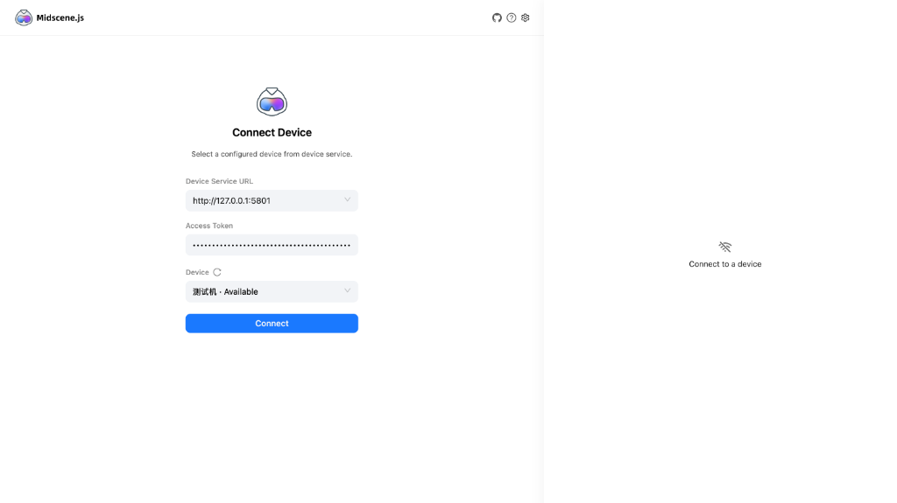
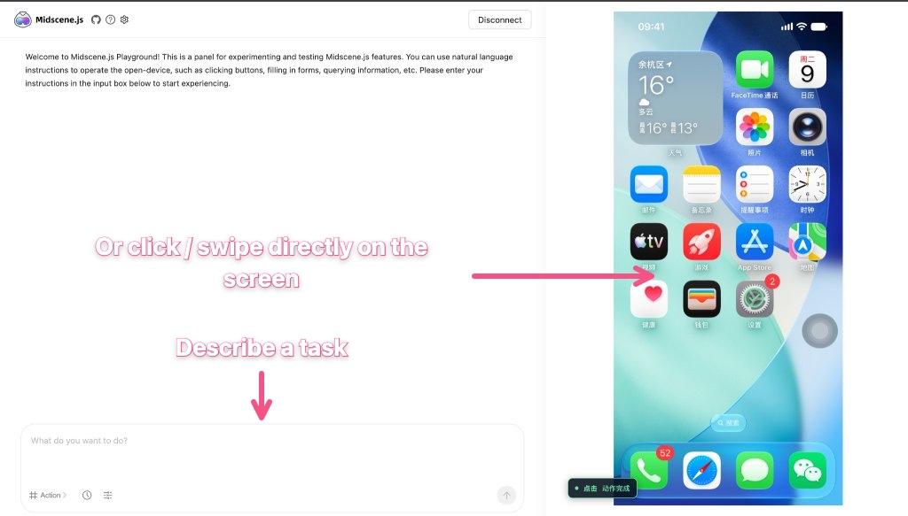

<p align="center">
  <br />
</p>

<h1 align="center">Midscene Universal Device</h1>

<p align="center">
  <strong>一套接口，测遍所有设备。</strong><br />
  Midscene 通用设备协议、SDK、CLI 与 MCP Server。
</p>

<p align="center">
  <a href="../../README.zh.md">Midscene Test Everything</a> ·
  <a href="./README.md">English</a> / 简体中文
</p>

## 💡 简介

Midscene Universal Device 是一套基于 HTTP 的开放协议，将任意可操作的屏幕接入 Midscene，以及 Codex、Claude Code、Cursor 等 AI Agent。

- **协议统一**：用标准的设备发现、独占会话、截图与输入接口，屏蔽底层差异。
- **能力全复用**：接入后即可使用 `aiAct`、`aiAssert`、`aiQuery` 等完整 Midscene 视觉测试能力。
- **多端调用**：提供 TypeScript SDK、CLI、MCP Server、Skill 与浏览器 Playground，兼顾代码测试与 Agent 调用。
- **易于扩展**：通过 `createDeviceHandler()` 封装自定义设备，无需从头实现协议细节。

```text
 Midscene SDK / CLI / MCP / Skill / Playground
                       │
           Universal Device HTTP API
        设备发现 · 独占会话 · 截图 · 输入
                       │
       AirLink / MG400 服务 / 自定义设备服务
                       │
                    被测屏幕
```

## 📋 环境准备

- **Node.js**：`20.19+`、`22.12+` 或 `24+`。
- **设备服务**：获取兼容服务的地址与访问 Token。若暂无现成服务，可先体验以下方案，或参考下文[接入自定义设备](#-接入自定义设备)：
  - **iOS AirLink**（iPhone 真机）：参考 [iOS AirLink 指南](../ios-airlink/README.zh.md)（默认地址 `http://localhost:5801`，可在管理页复制 Token）。
  - **机械臂**（车机 / 触屏）：参考 [DOBOT MG400 设备服务指南](../robot-arm/arm-service/README.md)。

## ⚡ 快速开始

### 1. 安装并验证连接

安装 `@midscene/universal-device`，设置服务地址和 Token，通过 CLI 验证连接：

```sh
npm install @midscene/universal-device
export MIDSCENE_UNIVERSAL_DEVICE_SERVICE_URL='http://localhost:5801'
export MIDSCENE_UNIVERSAL_DEVICE_SERVICE_TOKEN='<你的服务 Token>'

npx @midscene/universal-device devices # 列出当前服务可用设备
npx @midscene/universal-device screenshot screen.jpg # 获取当前设备屏幕截图
```


### 2. 运行第一个视觉测试

之后就可以用自然语言编写测试：

```js
import { agentFromUniversalDevice } from '@midscene/universal-device';

const agent = await agentFromUniversalDevice({
  host: process.env.MIDSCENE_UNIVERSAL_DEVICE_SERVICE_URL,
  deviceId: process.env.MIDSCENE_UNIVERSAL_DEVICE_ID,
});

try {
  await agent.aiAct('打开「设置」App，然后点击「通用」');
  await agent.aiAssert('屏幕上显示设置里的「通用」页面');
} finally {
  await agent.destroy();
}
```

## 🛠️ 使用方式

### CLI

```sh
# 查看设备列表及支持的操作
npx @midscene/universal-device devices

# 查看当前设备状态
npx @midscene/universal-device status

# 截取当前画面
npx @midscene/universal-device screenshot screen.jpg

# 发送点击操作（原点 (0, 0) 为截图左上角）
npx @midscene/universal-device action '{"type":"tap","point":{"x":120,"y":240}}'
```

单次 `screenshot` 或 `action` 会自动创建并释放临时会话。连续执行多条命令时，先运行 `acquire` 锁定会话，结束后运行 `release`。更多操作类型（如 `swipe`、`longPress`、`typeText`、`home` 等）见 [InputAction 定义](./docs/http-api.zh.md#inputaction)。

### MCP Server

在支持 MCP 的客户端（Codex、Claude Code、Cursor 等）中添加如下配置：

```json
{
  "mcpServers": {
    "universal-device": {
      "command": "npx",
      "args": ["-y", "@midscene/universal-device", "mcp"],
      "env": {
        "MIDSCENE_UNIVERSAL_DEVICE_SERVICE_URL": "<你的服务 URL>",
        "MIDSCENE_UNIVERSAL_DEVICE_SERVICE_TOKEN": "<你的服务 Token>"
      }
    }
  }
}
```

连接后，Agent 可调用 `list_devices`、`screenshot`、`execute_action` 与 `release_device`。

### Skill

仓库内置了 [`universal-device` Skill](../../skills/universal-device/SKILL.md)，可执行以下命令安装：

```sh
npx skills@latest add web-infra-dev/midscene-test-everything --skill universal-device
```

在环境或 `.env` 中配置 `MIDSCENE_UNIVERSAL_DEVICE_SERVICE_URL` 与 `MIDSCENE_UNIVERSAL_DEVICE_SERVICE_TOKEN` 后，即可在 Codex、Claude Code、Cursor 等 Agent 中操纵真实设备。

### Playground

运行以下命令启动 [Universal Device Playground](../universal-device-playground/README.md)，在浏览器中填入服务地址与 Token，即可实时预览画面并调试操作：

```sh
npx @midscene/universal-device-playground
```

| 连接设备 | 实时画面与调试 |
| --- | --- |
|  |  |

## 🧩 接入自定义设备

接入自定义设备只需提供三项能力：**设备信息**、**JPEG 截图**和**操作执行**（坐标以截图像素为准）。

使用 `@midscene/universal-device/server` 的 `createDeviceHandler()`，即可自动获得鉴权、会话管理与 Swagger UI，只需实现 `listDevices()` 与 `readyDevice(id)`：

```js
import { createServer } from 'node:http';
import { createDeviceHandler } from '@midscene/universal-device/server';

const device = { id: 'my-device', name: 'My Device', status: 'available', actions: ['tap'] };

const api = createDeviceHandler({
  token: process.env.MIDSCENE_UNIVERSAL_DEVICE_SERVICE_TOKEN ?? '',
  listDevices: () => [device],
  readyDevice: (id) => id === device.id ? {
    signal: new AbortController().signal,
    actions: device.actions,
    screenshot: async () => ({ jpeg: getFrameBuffer(), width: 800, height: 480, sequence: 1, receivedAt: Date.now() }),
    execute: async (action) => console.log('Execute:', action),
  } : undefined,
});

createServer((req, res) => {
  if (!api.handle(req, res)) res.writeHead(404).end();
}).listen(5900);
```

## 📖 HTTP API

基于 `@midscene/universal-device/server` 搭建的服务默认会在 `/api/docs/` 提供 Swagger UI，并在 `/api/openapi.json` 提供 OpenAPI 定义。

如需使用其他语言对接，完整的接口定义、状态码、请求与返回值类型说明请查阅 [HTTP API 参考](./docs/http-api.zh.md)。
